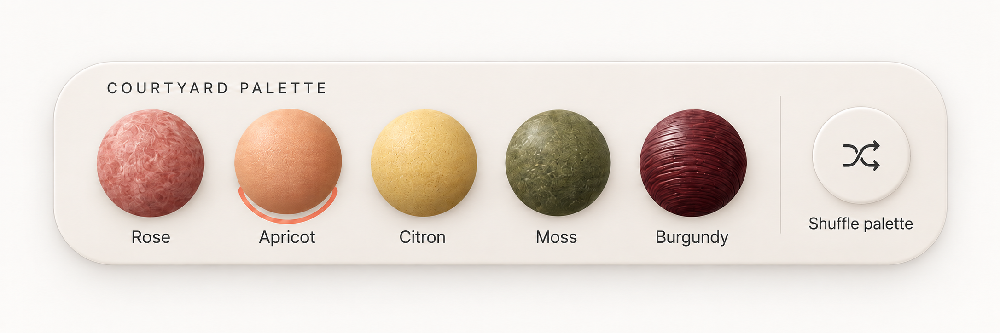
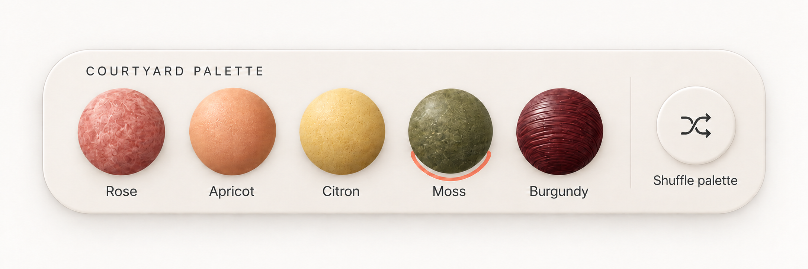
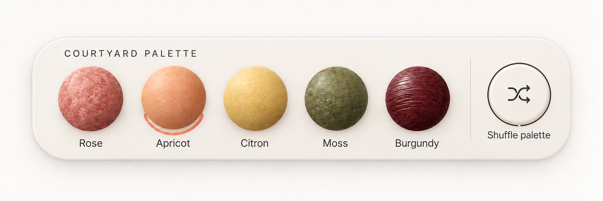
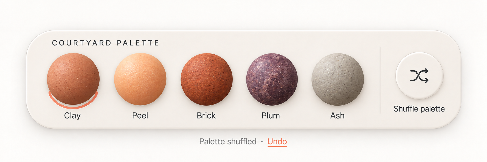
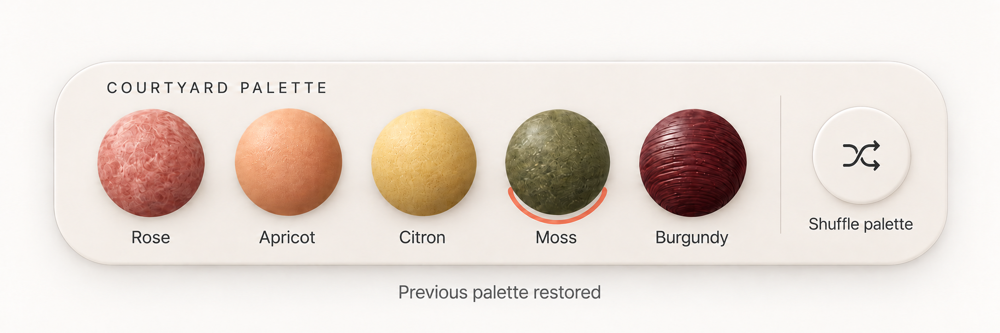

# Courtyard / Interaction ledger

WDA / Jason Festa · 21 October 2026

[Visual review](../reviews/courtyard.html) · [React prompt](../prompts/interaction/courtyard.md) · [Motion prompt](../prompts/motion/courtyard.md)

Five rendered states of the same component. Review order is an index; the action paths below define the actual transitions. Supporting loading, data and host-route branches are specified after the images.

## 01-apricot / Apricot selected

[Exact image prompt](../prompts/states/courtyard/01-apricot.md) · [Attached visual reference](../references/originals/courtyard.png)

- **Entry:** Initial palette.
- **Visible:** Rose, Apricot, Citron, Moss and Burgundy; only Apricot has the selection ring.
- **Exit / return:** Choose any material or focus Shuffle.

- **Choose Moss** → [02-moss](#02-moss). Selection commits.
- **Focus Shuffle** → [03-focus](#03-focus). Focus only, no palette change.

## 02-moss / Moss selected

[Exact image prompt](../prompts/states/courtyard/02-moss.md) · [Attached visual reference](../images/states/courtyard/01-apricot.png)

- **Entry:** Choose Moss.
- **Visible:** The original five materials remain; only Moss is selected.
- **Exit / return:** Shuffle captures this complete palette and Moss selection.

- **Shuffle palette** → [04-shuffled](#04-shuffled). Store original set and Moss.

## 03-focus / Shuffle focused

[Exact image prompt](../prompts/states/courtyard/03-focus.md) · [Attached visual reference](../images/states/courtyard/01-apricot.png)

- **Entry:** Tab to Shuffle from the Apricot baseline without activating.
- **Visible:** Apricot remains selected; a separate high-contrast outline surrounds Shuffle.
- **Exit / return:** Tab away removes only focus; Enter shuffles the currently selected palette.

- **Return to Apricot** → [01-apricot](#01-apricot). Blur only.
- **Choose Moss before shuffle** → [02-moss](#02-moss). Makes the illustrated undo path explicit.

## 04-shuffled / New palette

[Exact image prompt](../prompts/states/courtyard/04-shuffled.md) · [Attached visual reference](../images/states/courtyard/01-apricot.png)

- **Entry:** Activate Shuffle after choosing Moss for the illustrated undo path.
- **Visible:** Clay, Peel, Brick, Plum and Ash replace the original set; Clay selected; Palette shuffled · Undo.
- **Exit / return:** Undo restores the complete prior set and Moss, not an arbitrary default.

- **Undo shuffle** → [05-restored](#05-restored). Restore original set plus Moss.

## 05-restored / Undo restores selection

[Exact image prompt](../prompts/states/courtyard/05-restored.md) · [Attached visual reference](../images/states/courtyard/01-apricot.png)

- **Entry:** Activate Undo on the shuffled set.
- **Visible:** Original materials return with Moss selected; Previous palette restored.
- **Exit / return:** Shuffle again stores a new single-level snapshot.

- **Shuffle again** → [04-shuffled](#04-shuffled). Replace previous snapshot.

## Every control

### courtyard-swatch-rose / Rose

Scope: original · 1 element instances

- **Activation:** Set selectedMaterialId to this swatch ID.
- **Rollover:** Lift the sphere 2px on fine pointers; reveal a subtle ring preview without changing selection.
- **Touch / press:** Use the same action on tap; no hover prerequisite. Press feedback lasts 90 ms and never delays the state update.
- **Keyboard / focus:** Native labelled radio; arrows change selection, Space selects.
- **Result / return:** Exactly one selected material; label and preview derive from that ID.

Related images: [01-apricot](#01-apricot), [04-shuffled](#04-shuffled).

### courtyard-swatch-apricot / Apricot

Scope: original · 1 element instances

- **Activation:** Set selectedMaterialId to this swatch ID.
- **Rollover:** Lift the sphere 2px on fine pointers; reveal a subtle ring preview without changing selection.
- **Touch / press:** Use the same action on tap; no hover prerequisite. Press feedback lasts 90 ms and never delays the state update.
- **Keyboard / focus:** Native labelled radio; arrows change selection, Space selects.
- **Result / return:** Exactly one selected material; label and preview derive from that ID.

Related images: [01-apricot](#01-apricot).

### courtyard-swatch-citron / Citron

Scope: original · 1 element instances

- **Activation:** Set selectedMaterialId to this swatch ID.
- **Rollover:** Lift the sphere 2px on fine pointers; reveal a subtle ring preview without changing selection.
- **Touch / press:** Use the same action on tap; no hover prerequisite. Press feedback lasts 90 ms and never delays the state update.
- **Keyboard / focus:** Native labelled radio; arrows change selection, Space selects.
- **Result / return:** Exactly one selected material; label and preview derive from that ID.

Related images: [01-apricot](#01-apricot), [04-shuffled](#04-shuffled).

### courtyard-swatch-moss / Moss

Scope: original · 1 element instances

- **Activation:** Set selectedMaterialId to this swatch ID.
- **Rollover:** Lift the sphere 2px on fine pointers; reveal a subtle ring preview without changing selection.
- **Touch / press:** Use the same action on tap; no hover prerequisite. Press feedback lasts 90 ms and never delays the state update.
- **Keyboard / focus:** Native labelled radio; arrows change selection, Space selects.
- **Result / return:** Exactly one selected material; label and preview derive from that ID.

Related images: [02-moss](#02-moss), [05-restored](#05-restored).

### courtyard-swatch-burgundy / Burgundy

Scope: original · 1 element instances

- **Activation:** Set selectedMaterialId to this swatch ID.
- **Rollover:** Lift the sphere 2px on fine pointers; reveal a subtle ring preview without changing selection.
- **Touch / press:** Use the same action on tap; no hover prerequisite. Press feedback lasts 90 ms and never delays the state update.
- **Keyboard / focus:** Native labelled radio; arrows change selection, Space selects.
- **Result / return:** Exactly one selected material; label and preview derive from that ID.

Related images: [01-apricot](#01-apricot), [04-shuffled](#04-shuffled).

### courtyard-shuffle / Shuffle palette

Scope: original · 1 element instances

- **Activation:** Save current set and selection to history, then apply a new valid material set.
- **Rollover:** Shuffle icon rotates 15° on hover; complete one 180 ms turn on activation.
- **Touch / press:** Use the same action on tap; no hover prerequisite. Press feedback lasts 90 ms and never delays the state update.
- **Keyboard / focus:** Enter/Space; retain focus on the button; announce changed set.
- **Result / return:** Five new swatches, one selection and an available Undo.

Related images: [03-focus](#03-focus), [04-shuffled](#04-shuffled).

### courtyard-undo / Undo shuffle

Scope: proposed supporting control · 1 element instances

- **Activation:** Restore the preceding set and selectedMaterialId.
- **Rollover:** Underline and contrast change only.
- **Touch / press:** Use the same action on tap; no hover prerequisite. Press feedback lasts 90 ms and never delays the state update.
- **Keyboard / focus:** Enter/Space; announce restored palette.
- **Result / return:** The prior material set and selected ring return.

Related images: [04-shuffled](#04-shuffled), [05-restored](#05-restored).

### courtyard-new-materials / Clay / Peel / Brick / Plum / Ash

Scope: state control · 5 element instances

- **Activation:** Select one material in the shuffled set using stable IDs.
- **Rollover:** Increase contrast without committing a value. Use the same visible affordance for keyboard focus.
- **Touch / press:** Tap performs the same action. Show brief press feedback; prevent duplicate in-flight actions.
- **Keyboard / focus:** Native radio group; arrows select, Home/End select first/last.
- **Result / return:** One selected ring; Undo restores the prior set and selection.

Related images: [04-shuffled](#04-shuffled).

## Descriptive regions

Title, helper copy, count, price, divider and artwork are descriptive unless the control inventory assigns an action. Decorative layers use pointer-events:none and aria-hidden. Read-only regions have no hover lift, pointer cursor or tab stop.

## Supporting branches and all return paths

- Every original and shuffled sphere is a labelled radio. Left/Right changes the selected ID within the current set; Home/End select first/last. The selected ring and focus outline remain separate. Shuffle retains focus on the Shuffle button.
- Image 03 shows keyboard focus with Apricot selected. Enter here would save Apricot for Undo. Images 04–05 deliberately follow the Moss branch from image 02; restoring Moss is not a universal hardcoded default.
- Undo is one level. On restoration remove Undo and announce Previous palette restored. A library-loading failure keeps the existing palette, shows Couldn’t load palette and Retry; no empty set or mismatched names/assets.

## Rollover, motion and extraction

Only the hovered material lifts 2px; on selection the ring crossfades in 120 ms. Shuffle crossfades the set over 180 ms with no mixing of old labels and new artwork. There is no ambient rotation. Under reduced motion, update the entire set immediately.

Prepare five independent transparent material spheres plus a common shadow. Name files by stable material ID. Keep shape, camera, size and light fixed across every set. Do not extract labels or selected rings into the assets: those are DOM/CSS layers.

## Scroll, touch and accessibility

Let text reflow at 200% zoom. Keep every control operable by touch and keyboard, with a minimum 44 × 44 CSS-pixel hit area as a WDA design target. Preserve the component’s natural aspect ratio in raster review; the implementation reflows content rather than scaling text to fit.

Use a visible 2px high-contrast focus ring with 3px offset. Never make hover the only way to discover or activate a control.

Remove translation, rotation, parallax and looping animation. Selection, loading labels and focus remain visible; use an instant swap or an opacity change of at most 100 ms.

Keep the component in normal document flow. Do not hijack scrolling or drive selected values from scroll position. Pause optional decorative motion while offscreen.

The review explorer describes behavior; it does not send requests or store user data. Production persistence belongs to the host application and must reconcile pending/error states.

## React translation

MaterialPalette receives materials, selectedMaterialId and onSelect/onShuffle/onUndo. Store a full previous snapshot for undo; never derive identity from current array position. Use a fieldset of labelled radios, keeping shuffle outside the group.

- Exactly five named materials and one selected ring.
- Shuffle updates names, assets and IDs together.
- Undo restores both palette and selection.

## Alternative layout

On narrow surfaces, reflow to three swatches then two with the shuffle action below. Do not make the swatches too small to tap or force a long horizontal drag for core choices.

## Build references

- [W3C — radio group pattern](https://www.w3.org/WAI/ARIA/apg/patterns/radio/) — Courtyard keeps exactly one active material, with a visible ring and its text name.
- [Radix — Toggle Group build example](https://www.radix-ui.com/primitives/docs/components/toggle-group) — A useful implementation reference for compact controls. Courtyard still uses radio semantics because it requires a choice.
- [React — choosing state structure](https://react.dev/learn/choosing-the-state-structure) — Derive selected counts, button labels, usage totals and visible panels from stable IDs and shared data.
- [Motion — accessible animation](https://motion.dev/docs/react-accessibility) — Disable object drift, parallax and transform flourishes under reduced motion; keep selection and focus feedback.
