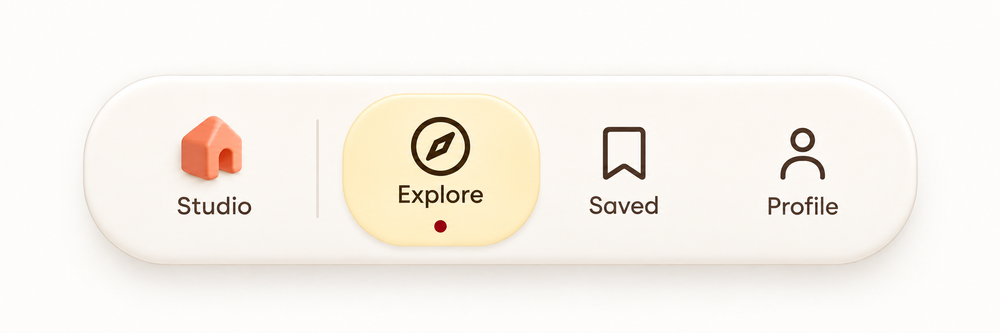
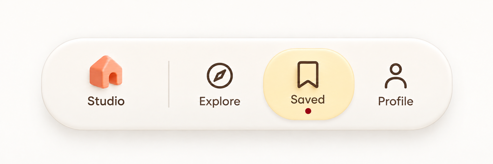
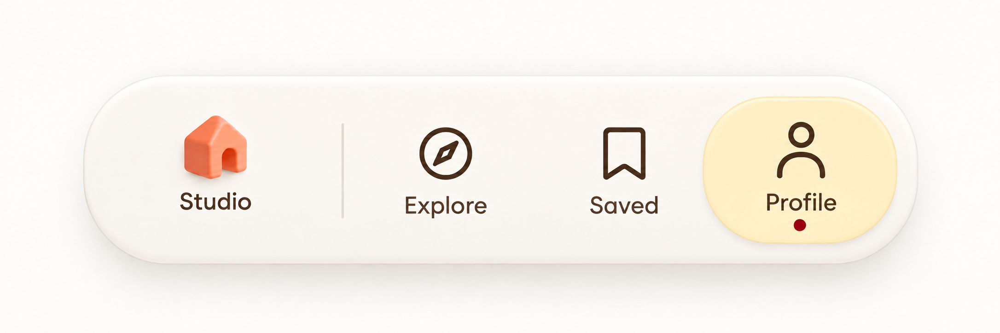
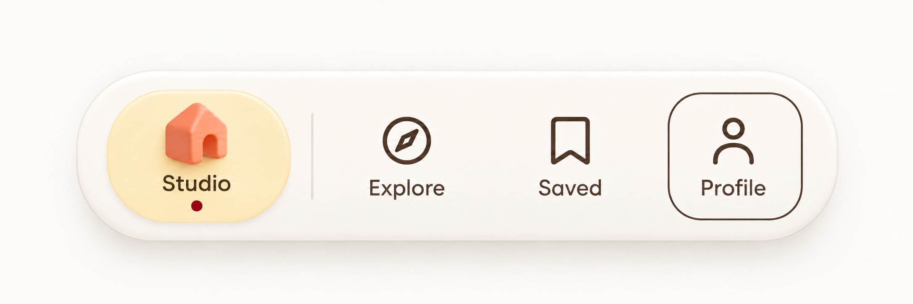

# Folio / Interaction ledger

WDA / Jason Festa · 21 October 2026

[Visual review](../reviews/folio.html) · [React prompt](../prompts/interaction/folio.md) · [Motion prompt](../prompts/motion/folio.md)

Five rendered states of the same component. Review order is an index; the action paths below define the actual transitions. Supporting loading, data and host-route branches are specified after the images.

## 01-studio / Studio

[Exact image prompt](../prompts/states/folio/01-studio.md) · [Attached visual reference](../references/originals/folio.png)

- **Entry:** The host route commits /studio.
- **Visible:** Studio alone has the citron active capsule and burgundy dot.
- **Exit / return:** Follow Explore, Saved or Profile.

- **Explore** → [02-explore](#02-explore). Commit /explore.
- **Saved** → [03-saved](#03-saved). Commit /saved.
- **Profile** → [04-profile](#04-profile). Commit /profile.
- **Focus Profile only** → [05-keyboard-focus](#05-keyboard-focus). Tab without Enter.

## 02-explore / Explore

[Exact image prompt](../prompts/states/folio/02-explore.md) · [Attached visual reference](../images/states/folio/01-studio.png)

- **Entry:** The host route commits /explore.
- **Visible:** Explore alone has the active capsule and dot; icon order and dock geometry stay fixed.
- **Exit / return:** Another link changes route; browser Back restores Studio.

- **Studio** → [01-studio](#01-studio). Commit /studio.
- **Saved** → [03-saved](#03-saved). Commit /saved.
- **Profile** → [04-profile](#04-profile). Commit /profile.

## 03-saved / Saved

[Exact image prompt](../prompts/states/folio/03-saved.md) · [Attached visual reference](../images/states/folio/01-studio.png)

- **Entry:** The host route commits /saved.
- **Visible:** Saved alone is current. The host content may show saved items or an empty collection.
- **Exit / return:** Choose another destination; Browse Explore from empty content opens Explore.

- **Studio** → [01-studio](#01-studio). Commit /studio.
- **Explore** → [02-explore](#02-explore). Includes empty-state Browse Explore.
- **Profile** → [04-profile](#04-profile). Commit /profile.

## 04-profile / Profile

[Exact image prompt](../prompts/states/folio/04-profile.md) · [Attached visual reference](../images/states/folio/01-studio.png)

- **Entry:** The host route commits /profile.
- **Visible:** Profile alone is current. Account/sign-in content is owned by the host.
- **Exit / return:** Navigate away or finish/cancel sign-in while preserving returnTo=/profile.

- **Studio** → [01-studio](#01-studio). Commit /studio.
- **Explore** → [02-explore](#02-explore). Commit /explore.
- **Saved** → [03-saved](#03-saved). Commit /saved.

## 05-keyboard-focus / Focus without navigation

[Exact image prompt](../prompts/states/folio/05-keyboard-focus.md) · [Attached visual reference](../images/states/folio/01-studio.png)

- **Entry:** While Studio is current, Tab through the links until Profile has focus.
- **Visible:** Studio keeps the only active capsule and dot; Profile has an outline only.
- **Exit / return:** Enter follows Profile; Tab away moves focus without navigation.

- **Enter follows Profile** → [04-profile](#04-profile). Commit before moving current marker.
- **Blur without navigating** → [01-studio](#01-studio). Studio stays current.

## Every control

### folio-studio / Studio

Scope: original · 1 element instances

- **Activation:** Navigate to /studio; update active treatment only when the route commits.
- **Rollover:** Soft surface tint and at most a 2px icon lift. Hover never marks a route current.
- **Touch / press:** Use the same action on tap; no hover prerequisite. Press feedback lasts 90 ms and never delays the state update.
- **Keyboard / focus:** Native links; Tab visits each, Enter follows. Preserve browser Back and modified clicks.
- **Result / return:** Exactly one aria-current link and matching route content.

Related images: [01-studio](#01-studio).

### folio-explore / Explore

Scope: original · 1 element instances

- **Activation:** Navigate to /explore; update active treatment only when the route commits.
- **Rollover:** Soft surface tint and at most a 2px icon lift. Hover never marks a route current.
- **Touch / press:** Use the same action on tap; no hover prerequisite. Press feedback lasts 90 ms and never delays the state update.
- **Keyboard / focus:** Native links; Tab visits each, Enter follows. Preserve browser Back and modified clicks.
- **Result / return:** Exactly one aria-current link and matching route content.

Related images: [02-explore](#02-explore).

### folio-saved / Saved

Scope: original · 1 element instances

- **Activation:** Navigate to /saved; update active treatment only when the route commits.
- **Rollover:** Soft surface tint and at most a 2px icon lift. Hover never marks a route current.
- **Touch / press:** Use the same action on tap; no hover prerequisite. Press feedback lasts 90 ms and never delays the state update.
- **Keyboard / focus:** Native links; Tab visits each, Enter follows. Preserve browser Back and modified clicks.
- **Result / return:** Exactly one aria-current link and matching route content.

Related images: [03-saved](#03-saved).

### folio-profile / Profile

Scope: original · 1 element instances

- **Activation:** Navigate to /profile; update active treatment only when the route commits.
- **Rollover:** Soft surface tint and at most a 2px icon lift. Hover never marks a route current.
- **Touch / press:** Use the same action on tap; no hover prerequisite. Press feedback lasts 90 ms and never delays the state update.
- **Keyboard / focus:** Native links; Tab visits each, Enter follows. Preserve browser Back and modified clicks.
- **Result / return:** Exactly one aria-current link and matching route content.

Related images: [04-profile](#04-profile).

### folio-browse / Browse Explore from empty Saved

Scope: proposed supporting control · 1 element instances

- **Activation:** Navigate to Explore from a clearly labelled empty state.
- **Rollover:** Underline and contrast feedback.
- **Touch / press:** Use the same action on tap; no hover prerequisite. Press feedback lasts 90 ms and never delays the state update.
- **Keyboard / focus:** Native link; Enter follows.
- **Result / return:** Explore selected; Back returns to Saved.

Related images: [03-saved](#03-saved), [02-explore](#02-explore).

### folio-signin / Sign in / Cancel

Scope: proposed supporting control · 1 element instances

- **Activation:** Open sign-in with returnTo=/profile; preserve intent.
- **Rollover:** Standard button/link feedback without icon motion.
- **Touch / press:** Use the same action on tap; no hover prerequisite. Press feedback lasts 90 ms and never delays the state update.
- **Keyboard / focus:** Use a labelled dialog or route with an explicit cancel/back path.
- **Result / return:** Return to Profile after completion or cancellation.

Related images: [04-profile](#04-profile).

### folio-retry / Retry destination

Scope: proposed supporting control · 1 element instances

- **Activation:** Retry a failed route while preserving the last successful route.
- **Rollover:** Visible error text and a labelled Retry button.
- **Touch / press:** Use the same action on tap; no hover prerequisite. Press feedback lasts 90 ms and never delays the state update.
- **Keyboard / focus:** Native button; maintain focus until success.
- **Result / return:** Successful destination becomes the only current item.

Related images: [05-keyboard-focus](#05-keyboard-focus).

## Descriptive regions

Title, helper copy, count, price, divider and artwork are descriptive unless the control inventory assigns an action. Decorative layers use pointer-events:none and aria-hidden. Read-only regions have no hover lift, pointer cursor or tab stop.

## Supporting branches and all return paths

- Native links preserve browser Back/Forward, modified clicks and deep links. Active state derives from committed route; nested saved-item routes remain under Saved. The dock does not replace route content in the host.
- Saved empty content offers Browse Explore. Profile signed out offers sign-in with returnTo=/profile; cancel and completion both return there. Loading and error feedback live in the host content without changing item order.
- During pending navigation retain the last committed active marker and show an accessible loading label in host content. A failed route leaves the old marker and Retry; successful commit moves the marker and focuses the new page heading. Hover and focus never commit navigation.
- All four icons and labels activate their enclosing link; divider, shell and active dot are decorative. On mobile reserve dock space so it cannot obscure page content; use safe-area padding in implementation without adding OS chrome to artwork.

## Rollover, motion and extraction

Move the active capsule between equal-width destination slots over 180 ms after a route commit. The coral house may settle by 2px once on Studio entry; other line icons do not morph into invented objects. Under reduced motion, swap the active treatment instantly.

Prepare a separate coral house asset with transparent background and one consistent line-icon set for compass, bookmark and profile. Rebuild pill, dot, labels and divider in CSS/SVG. A 3D house should use a stable camera and a lightweight mesh only if interactive tilt is approved.

## Scroll, touch and accessibility

Let text reflow at 200% zoom. Keep every control operable by touch and keyboard, with a minimum 44 × 44 CSS-pixel hit area as a WDA design target. Preserve the component’s natural aspect ratio in raster review; the implementation reflows content rather than scaling text to fit.

Use a visible 2px high-contrast focus ring with 3px offset. Never make hover the only way to discover or activate a control.

Remove translation, rotation, parallax and looping animation. Selection, loading labels and focus remain visible; use an instant swap or an opacity change of at most 100 ms.

Keep the component in normal document flow. Do not hijack scrolling or drive selected values from scroll position. Pause optional decorative motion while offscreen.

The review explorer describes behavior; it does not send requests or store user data. Production persistence belongs to the host application and must reconcile pending/error states.

## React translation

NavigationDock receives items with stable IDs/hrefs and currentPath. Derive current item from router state, not independent button state. Preserve query parameters and route history. The host owns auth and async route loading; dock reflects their results.

- Exactly four destinations in fixed order.
- One current item, one active dot and matching content.
- Hover/focus never change the current route.
- Browser Back restores the prior active item.

## Alternative layout

A compact bottom navigation can retain all four visible labels and a smaller active capsule. Add safe-area padding in the host shell. Do not reproduce an OS home indicator or hide labels behind tooltips.

## Build references

- [MDN — aria-current](https://developer.mozilla.org/en-US/docs/Web/Accessibility/ARIA/Reference/Attributes/aria-current) — Folio uses navigation links and aria-current="page" for routes. Use tabs only if switching local panels.
- [W3C — tabs pattern](https://www.w3.org/WAI/ARIA/apg/patterns/tabs/) — Sol day selection, Roam plan previews and Kiln reporting periods use one active panel. Focus and selection are tracked separately.
- [React — choosing state structure](https://react.dev/learn/choosing-the-state-structure) — Derive selected counts, button labels, usage totals and visible panels from stable IDs and shared data.
- [Motion — accessible animation](https://motion.dev/docs/react-accessibility) — Disable object drift, parallax and transform flourishes under reduced motion; keep selection and focus feedback.
