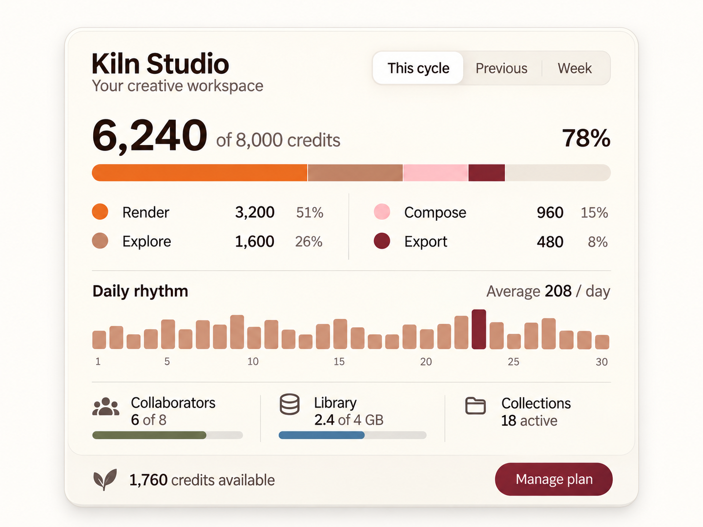
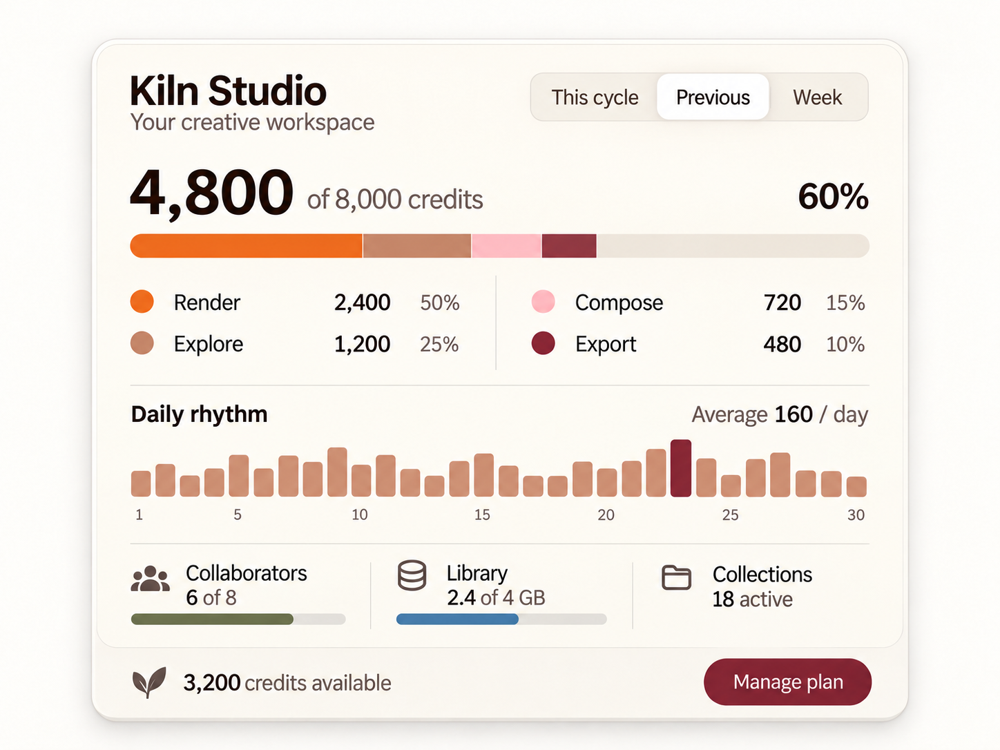
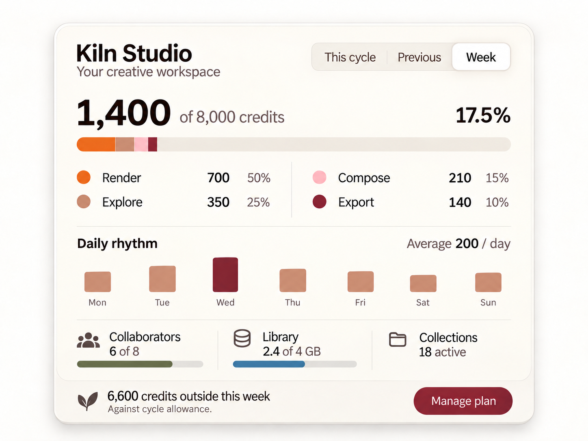
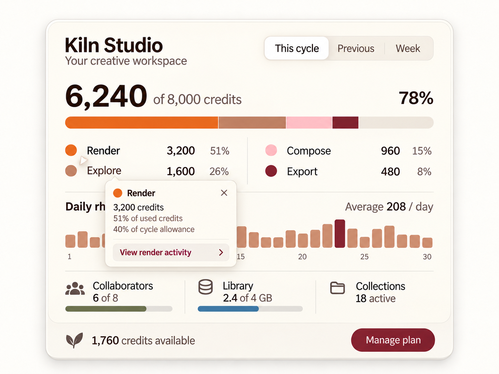
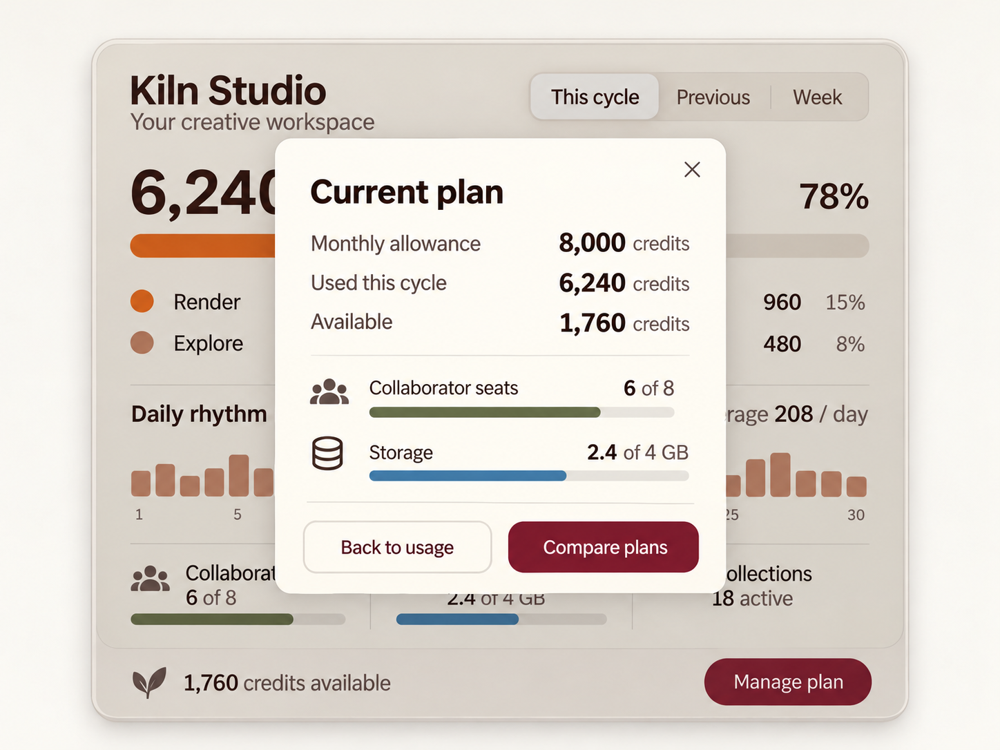

# Kiln / Interaction ledger

WDA / Jason Festa · 21 October 2026

[Visual review](../reviews/kiln.html) · [React prompt](../prompts/interaction/kiln.md) · [Motion prompt](../prompts/motion/kiln.md)

Five rendered states of the same component. Review order is an index; the action paths below define the actual transitions. Supporting loading, data and host-route branches are specified after the images.

## 01-cycle / This cycle

[Exact image prompt](../prompts/states/kiln/01-cycle.md) · [Attached visual reference](../references/originals/kiln.png)

- **Entry:** Load the confirmed current 30-day cycle.
- **Visible:** 6,240/8,000 (78%), categories 3,200/1,600/960/480, average 208/day; 1,760 available.
- **Exit / return:** Switch period, inspect a category or manage the plan.

- **Previous cycle** → [02-previous](#02-previous). Load a coherent dataset.
- **This week** → [03-week](#03-week). Load seven-day fixture.
- **Inspect Render** → [04-detail](#04-detail). Keep cycle totals visible.
- **Manage plan** → [05-manage](#05-manage). No charge.

## 02-previous / Previous cycle

[Exact image prompt](../prompts/states/kiln/02-previous.md) · [Attached visual reference](../images/states/kiln/01-cycle.png)

- **Entry:** Activate Previous and resolve its whole dataset.
- **Visible:** 4,800/8,000 (60%); categories 2,400/1,200/720/480; average 160/day; 3,200 available.
- **Exit / return:** Return to This cycle or choose Week.

- **This cycle** → [01-cycle](#01-cycle). Restore the current cycle.
- **This week** → [03-week](#03-week). Load seven-day fixture.

## 03-week / This week

[Exact image prompt](../prompts/states/kiln/03-week.md) · [Attached visual reference](../images/states/kiln/01-cycle.png)

- **Entry:** Activate Week and resolve its seven-day dataset.
- **Visible:** 1,400/8,000 (17.5%); 700/350/210/140; average 200/day; seven weekday bars. The 6,600 difference is against the allowance, not remaining balance this cycle.
- **Exit / return:** Switch period or inspect a day; the resource snapshots remain account-wide.

- **This cycle** → [01-cycle](#01-cycle). Return to actual remaining cycle balance.
- **Previous cycle** → [02-previous](#02-previous). Switch whole dataset.

## 04-detail / Inspect Render usage

[Exact image prompt](../prompts/states/kiln/04-detail.md) · [Attached visual reference](../images/states/kiln/01-cycle.png)

- **Entry:** Activate Render from This cycle.
- **Visible:** Render popover: 3,200 credits; 51% of used credits; 40% of cycle allowance; View render activity and Close.
- **Exit / return:** Close returns focus to Render; View render activity opens a filtered host detail view.

- **Close detail** → [01-cycle](#01-cycle). Restore focus to Render.

## 05-manage / Manage plan

[Exact image prompt](../prompts/states/kiln/05-manage.md) · [Attached visual reference](../images/states/kiln/01-cycle.png)

- **Entry:** Activate Manage plan from This cycle.
- **Visible:** Current plan dialog: 8,000 allowance, 6,240 used, 1,760 available, 6/8 seats and 2.4/4 GB; Compare plans, Back to usage, Close.
- **Exit / return:** Back/Close returns to the same cycle; Compare plans opens the host’s verified catalogue.

- **Back to usage** → [01-cycle](#01-cycle). Restore focus to Manage plan.

## Every control

### kiln-periods / This cycle / Previous / Week

Scope: original · 3 element instances

- **Activation:** Choose one reporting range and fetch its aggregate and series as a unit.
- **Rollover:** Warm tab highlight; no data changes on hover.
- **Touch / press:** Use the same action on tap; no hover prerequisite. Press feedback lasts 90 ms and never delays the state update.
- **Keyboard / focus:** Manual activation tabs with labelled panels.
- **Result / return:** Every label and chart refers to the same reporting range.

Related images: [01-cycle](#01-cycle), [02-previous](#02-previous), [03-week](#03-week).

### kiln-categories / Render / Explore / Compose / Export

Scope: original · 4 element instances

- **Activation:** Open category details or a labelled transaction filter.
- **Rollover:** Highlight the segment and matching legend; show exact value and denominator.
- **Touch / press:** Use the same action on tap; no hover prerequisite. Press feedback lasts 90 ms and never delays the state update.
- **Keyboard / focus:** Focusable category buttons; Enter/Space opens details.
- **Result / return:** Filtered details; the overall capacity summary remains explicitly unfiltered.

Related images: [04-detail](#04-detail).

### kiln-daily / Daily rhythm bars

Scope: original · 30 element instances

- **Activation:** Reveal date and credits for the focused/hovered day; click opens that day’s detail.
- **Rollover:** Single highlighted bar with anchored tooltip; no expanding bar that changes apparent value.
- **Touch / press:** Use the same action on tap; no hover prerequisite. Press feedback lasts 90 ms and never delays the state update.
- **Keyboard / focus:** One chart tab stop with arrow-key traversal, plus a complete data table. Escape dismisses tooltip.
- **Result / return:** Date-specific detail with Back and persistent period selection.

Related images: [01-cycle](#01-cycle), [02-previous](#02-previous), [03-week](#03-week).

### kiln-collaborators / Collaborators · 6 of 8

Scope: original · 1 element instances

- **Activation:** Open collaborator management.
- **Rollover:** Underline the label and lighten its resource region.
- **Touch / press:** Use the same action on tap; no hover prerequisite. Press feedback lasts 90 ms and never delays the state update.
- **Keyboard / focus:** Native link; accessible label includes 6 of 8 seats.
- **Result / return:** Host members route, returning to the same period.

Related images: [01-cycle](#01-cycle), [05-manage](#05-manage).

### kiln-library / Library · 2.4 of 4 GB

Scope: original · 1 element instances

- **Activation:** Open storage details.
- **Rollover:** Underline the label and preserve bar width.
- **Touch / press:** Use the same action on tap; no hover prerequisite. Press feedback lasts 90 ms and never delays the state update.
- **Keyboard / focus:** Native link; units in accessible name.
- **Result / return:** Host storage route; 60% usage derived from 2.4/4.

Related images: [01-cycle](#01-cycle), [05-manage](#05-manage).

### kiln-collections / Collections · 18 active

Scope: original · 1 element instances

- **Activation:** Open the collections list.
- **Rollover:** Underline the label; do not suggest an undefined limit.
- **Touch / press:** Use the same action on tap; no hover prerequisite. Press feedback lasts 90 ms and never delays the state update.
- **Keyboard / focus:** Native link; announce active count.
- **Result / return:** Collections route; no fabricated utilization percentage.

Related images: [01-cycle](#01-cycle).

### kiln-manage / Manage plan

Scope: original · 1 element instances

- **Activation:** Open a labelled billing overview with current plan and verified options.
- **Rollover:** Burgundy button brightens without looping motion.
- **Touch / press:** Use the same action on tap; no hover prerequisite. Press feedback lasts 90 ms and never delays the state update.
- **Keyboard / focus:** Native link or dialog trigger; restore focus on return.
- **Result / return:** Host billing route; this control does not charge the user.

Related images: [05-manage](#05-manage).

### kiln-table / View data table / Clear filter

Scope: proposed supporting control · 1 element instances

- **Activation:** Provide textual chart values and remove a detail filter.
- **Rollover:** Underline the explicit action.
- **Touch / press:** Use the same action on tap; no hover prerequisite. Press feedback lasts 90 ms and never delays the state update.
- **Keyboard / focus:** Native disclosure/button; table headers name units and dates.
- **Result / return:** Accessible series and consistent totals.

Related images: [04-detail](#04-detail).

### kiln-retry / Retry range

Scope: proposed supporting control · 1 element instances

- **Activation:** Retry the chosen period request.
- **Rollover:** Loading label and duplicate-click protection.
- **Touch / press:** Use the same action on tap; no hover prerequisite. Press feedback lasts 90 ms and never delays the state update.
- **Keyboard / focus:** Enter/Space; announce result.
- **Result / return:** Confirmed data or a continued unavailable state.

Related images: [01-cycle](#01-cycle), [02-previous](#02-previous), [03-week](#03-week).

### kiln-close / Close detail / Back to usage

Scope: state control · 1 element instances

- **Activation:** Dismiss the category popover or plan dialog.
- **Rollover:** Increase contrast without committing a value. Use the same visible affordance for keyboard focus.
- **Touch / press:** Tap performs the same action. Show brief press feedback; prevent duplicate in-flight actions.
- **Keyboard / focus:** Enter/Space activates. Escape dismisses an open overlay and restores focus to its trigger.
- **Result / return:** Restore focus to the corresponding trigger without resetting range.

Related images: [01-cycle](#01-cycle), [04-detail](#04-detail), [05-manage](#05-manage).

### kiln-compare / Compare plans

Scope: state control · 1 element instances

- **Activation:** Open the host verified plan catalogue.
- **Rollover:** Increase contrast without committing a value. Use the same visible affordance for keyboard focus.
- **Touch / press:** Tap performs the same action. Show brief press feedback; prevent duplicate in-flight actions.
- **Keyboard / focus:** Enter/Space activates. Escape dismisses an open overlay and restores focus to its trigger.
- **Result / return:** Plan comparison with its own loading, retry and Back paths; no automatic upgrade.

Related images: [05-manage](#05-manage).

### kiln-activity / View render activity

Scope: state control · 1 element instances

- **Activation:** Open the host category transaction table for Render and the active range.
- **Rollover:** Increase contrast without committing a value. Use the same visible affordance for keyboard focus.
- **Touch / press:** Tap performs the same action. Show brief press feedback; prevent duplicate in-flight actions.
- **Keyboard / focus:** Enter/Space activates. Escape dismisses an open overlay and restores focus to its trigger.
- **Result / return:** Filtered activity; Back restores the same range and category.

Related images: [04-detail](#04-detail).

## Descriptive regions

Title, helper copy, count, price, divider and artwork are descriptive unless the control inventory assigns an action. Decorative layers use pointer-events:none and aria-hidden. Read-only regions have no hover lift, pointer cursor or tab stop.

## Supporting branches and all return paths

- Explore, Compose and Export reuse Render’s popover with their own totals and explicit used-versus-allowance percentages. Close/Escape/outside click restores focus. View activity opens a host filtered table; Back restores the originating range and filter.
- Daily bars expose exact date and credits on hover or focus. Touch toggles the same tooltip; Escape closes. One chart tab stop supports arrow traversal; a View data table action exposes all values. Daily arrays in fixtures.json are proposed build data; raster bar heights are illustrative, not a data source.
- Period loading keeps the prior range clearly labelled until success; failure shows Couldn’t load this range, timestamp and Retry. No-data and true-zero datasets are distinct. Near capacity, add a textual warning at 95% without forcing an upgrade.
- Collaborators, Library and Collections link to host members, storage and collection routes. Preserve period on return. Collections is a count with no fabricated limit. Compare plans opens a verified host catalogue, with loading, retry and Back paths. The 6,600 weekly difference is not spendable remaining credit.

## Rollover, motion and extraction

Animate bars from their previous validated value to the next over 220 ms, only after successful data loading. Never animate from zero on every scroll. Tooltip fades over 80 ms. Under reduced motion, values and widths update immediately. Chart motion is programmatic, not rendered video.

Rebuild bars, labels, legends and counters as HTML/SVG from real data. Keep the leaf mark as a separate decorative vector if desired. Do not extract an animated chart from the screenshot or turn data into a looping video.

## Scroll, touch and accessibility

Let text reflow at 200% zoom. Keep every control operable by touch and keyboard, with a minimum 44 × 44 CSS-pixel hit area as a WDA design target. Preserve the component’s natural aspect ratio in raster review; the implementation reflows content rather than scaling text to fit.

Use a visible 2px high-contrast focus ring with 3px offset. Never make hover the only way to discover or activate a control.

Remove translation, rotation, parallax and looping animation. Selection, loading labels and focus remain visible; use an instant swap or an opacity change of at most 100 ms.

Keep the component in normal document flow. Do not hijack scrolling or drive selected values from scroll position. Pause optional decorative motion while offscreen.

The review explorer describes behavior; it does not send requests or store user data. Production persistence belongs to the host application and must reconcile pending/error states.

## React translation

UsagePanel receives range, totals, categories, dailySeries, resources and requestStatus. Derive used = sum(categories), percent = used / limit and remaining = limit - used. Category ratios explicitly state their denominator. Keep range-filtered detail separate from the capacity summary.

- 3,200 + 1,600 + 960 + 480 = 6,240.
- 6,240 / 8,000 = 78%; remaining = 1,760.
- 6,240 / 30 = 208 per day.
- Capacity widths: 40 + 20 + 12 + 6 + 22 = 100%.
- Collections has no defined capacity limit.

## Alternative layout

A narrow stacked layout puts the capacity total first, the category table second, daily rhythm third and resources last. Keep the graph available without making it the only way to read values.

## Build references

- [Supabase — usage documentation](https://supabase.com/docs/guides/platform/manage-your-usage) — Kiln needs explicit units, denominator labels and category details. This is a structure reference, not a copied pricing model.
- [W3C — complex images and charts](https://www.w3.org/WAI/tutorials/images/complex/) — Kiln exposes a data table and values in text; hover tooltips are supplemental.
- [W3C — tabs pattern](https://www.w3.org/WAI/ARIA/apg/patterns/tabs/) — Sol day selection, Roam plan previews and Kiln reporting periods use one active panel. Focus and selection are tracked separately.
- [W3C — modal dialog pattern](https://www.w3.org/WAI/ARIA/apg/patterns/dialog-modal/) — Roam review and Kiln plan details need explicit close/cancel paths with trigger focus restoration.
- [React — choosing state structure](https://react.dev/learn/choosing-the-state-structure) — Derive selected counts, button labels, usage totals and visible panels from stable IDs and shared data.
