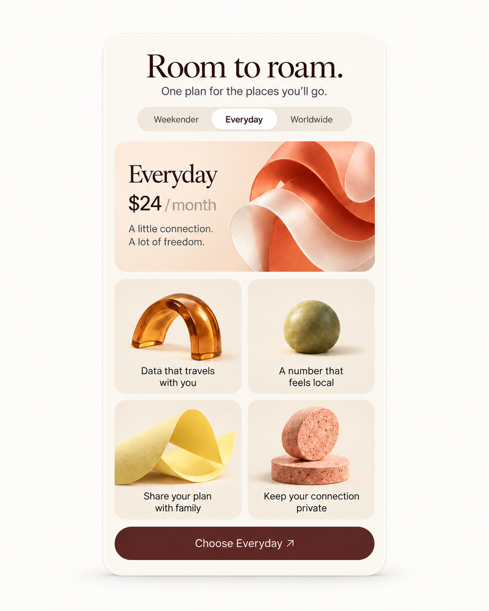
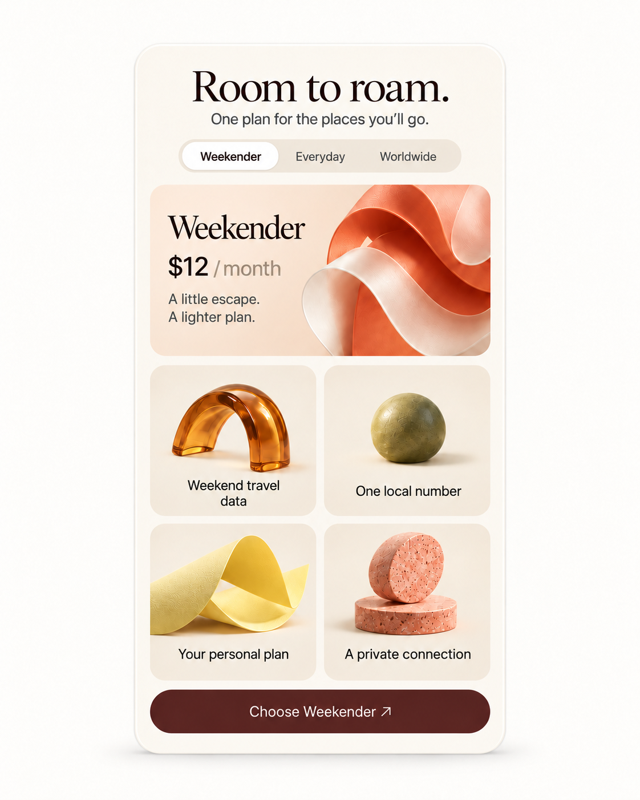
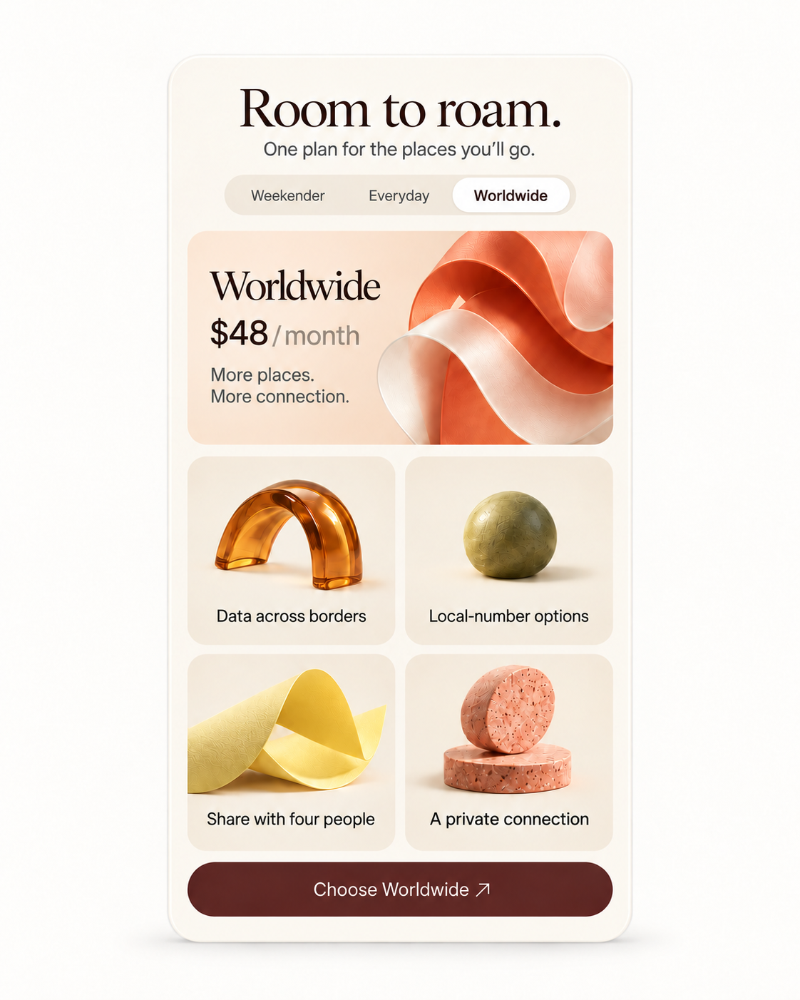
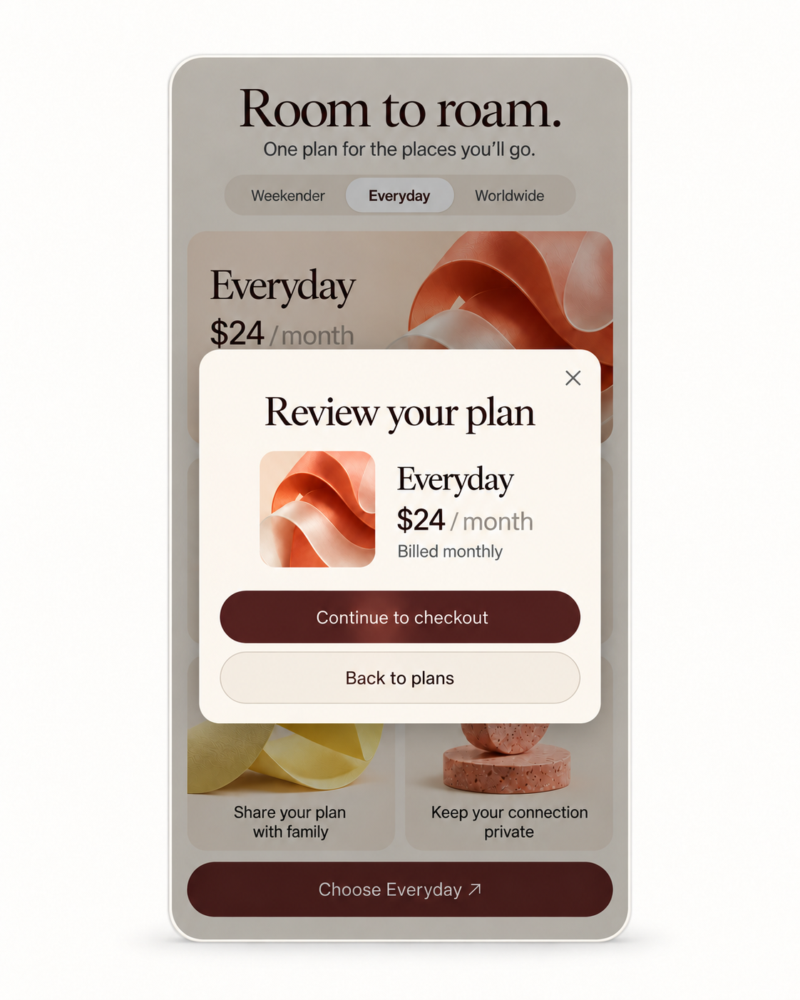
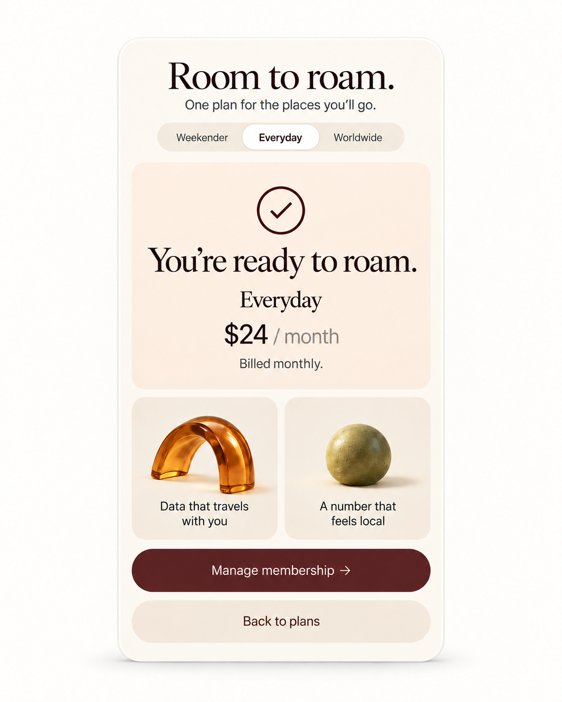

# Roam / Interaction ledger

WDA / Jason Festa · 21 October 2026

[Visual review](../reviews/roam.html) · [React prompt](../prompts/interaction/roam.md) · [Motion prompt](../prompts/motion/roam.md)

Five rendered states of the same component. Review order is an index; the action paths below define the actual transitions. Supporting loading, data and host-route branches are specified after the images.

## 01-everyday / Everyday plan

[Exact image prompt](../prompts/states/roam/01-everyday.md) · [Attached visual reference](../references/originals/roam.png)

- **Entry:** Initial plan preview.
- **Visible:** Everyday selected; $24/month and its four original benefits.
- **Exit / return:** Choose another plan or review Everyday.

- **Preview Weekender** → [02-weekender](#02-weekender). Proposed $12 fixture.
- **Preview Worldwide** → [03-worldwide](#03-worldwide). Proposed $48 fixture.
- **Choose Everyday** → [04-review](#04-review). Opens review; no charge.

## 02-weekender / Weekender plan

[Exact image prompt](../prompts/states/roam/02-weekender.md) · [Attached visual reference](../images/states/roam/01-everyday.png)

- **Entry:** Activate Weekender.
- **Visible:** Weekender, $12/month; Weekend travel data, One local number, Your personal plan, A private connection; matching CTA.
- **Exit / return:** Switch plans or review this plan using its own fixture data.

- **Preview Everyday** → [01-everyday](#01-everyday). Restore $24 fixture.
- **Preview Worldwide** → [03-worldwide](#03-worldwide). Plan fields change together.

## 03-worldwide / Worldwide plan

[Exact image prompt](../prompts/states/roam/03-worldwide.md) · [Attached visual reference](../images/states/roam/01-everyday.png)

- **Entry:** Activate Worldwide.
- **Visible:** Worldwide, $48/month; Data across borders, Local-number options, Share with four people, A private connection; matching CTA.
- **Exit / return:** Switch plans or review the selected plan.

- **Preview Everyday** → [01-everyday](#01-everyday). Restore $24 fixture.
- **Preview Weekender** → [02-weekender](#02-weekender). Plan fields change together.

## 04-review / Review chosen plan

[Exact image prompt](../prompts/states/roam/04-review.md) · [Attached visual reference](../images/states/roam/01-everyday.png)

- **Entry:** Choose Everyday from its preview.
- **Visible:** Review your plan dialog; Everyday, $24/month, Billed monthly; Continue to checkout, Back to plans, Close.
- **Exit / return:** Back/Close cancels; Continue requests a checkout session. Confirmation requires verified completion.

- **Back to plans** → [01-everyday](#01-everyday). No purchase.
- **Verified checkout completes** → [05-confirmed](#05-confirmed). Review simulation: host checkout must finish before showing this screen.

## 05-confirmed / Confirmation

[Exact image prompt](../prompts/states/roam/05-confirmed.md) · [Attached visual reference](../images/states/roam/01-everyday.png)

- **Entry:** The host reports verified Everyday checkout completion.
- **Visible:** You’re ready to roam; Everyday $24/month; Manage membership and Back to plans.
- **Exit / return:** Manage opens the membership account; Back returns to plan comparison without cancelling membership.

- **Back to plans** → [01-everyday](#01-everyday). Keeps the completed membership.

## Every control

### roam-plans / Weekender / Everyday / Worldwide

Scope: original · 3 element instances

- **Activation:** Select a plan preview from canonical plan data.
- **Rollover:** Warm raised pill; never change price on hover.
- **Touch / press:** Use the same action on tap; no hover prerequisite. Press feedback lasts 90 ms and never delays the state update.
- **Keyboard / focus:** Manual-activation tabs; arrows move focus and Enter/Space selects.
- **Result / return:** Plan heading, price, benefits and CTA update together.

Related images: [01-everyday](#01-everyday), [02-weekender](#02-weekender), [03-worldwide](#03-worldwide).

### roam-choose / Choose selected plan

Scope: original · 1 element instances

- **Activation:** Validate availability then open a review of the selected plan.
- **Rollover:** Burgundy CTA brightens subtly; arrow moves 2px without moving text.
- **Touch / press:** Use the same action on tap; no hover prerequisite. Press feedback lasts 90 ms and never delays the state update.
- **Keyboard / focus:** Enter/Space; focus moves into review dialog.
- **Result / return:** Plan review; no purchase is made from selection alone.

Related images: [04-review](#04-review).

### roam-features / Four feature tiles

Scope: original information; optional extension · 4 element instances

- **Activation:** Read the four benefits for the selected plan. These tiles are static information.
- **Rollover:** No pointer cursor, hover lift or hidden action.
- **Touch / press:** No action on tap.
- **Keyboard / focus:** Not focusable; read in document order.
- **Result / return:** Benefits remain tied to the selected plan.

Related images: [01-everyday](#01-everyday), [02-weekender](#02-weekender), [03-worldwide](#03-worldwide).

### roam-continue / Continue to checkout

Scope: proposed supporting control · 1 element instances

- **Activation:** Create checkout for the reviewed plan ID and confirmed price.
- **Rollover:** Clear pending state; disable duplicate submission.
- **Touch / press:** Use the same action on tap; no hover prerequisite. Press feedback lasts 90 ms and never delays the state update.
- **Keyboard / focus:** Native button; label progress, then navigate on success.
- **Result / return:** Checkout destination or inline error; server verifies all prices.

Related images: [04-review](#04-review), [05-confirmed](#05-confirmed).

### roam-cancel / Cancel / Back to plans

Scope: proposed supporting control · 1 element instances

- **Activation:** Close review or error without changing the selected plan.
- **Rollover:** Secondary text action, visible focus.
- **Touch / press:** Use the same action on tap; no hover prerequisite. Press feedback lasts 90 ms and never delays the state update.
- **Keyboard / focus:** Escape or button; restore focus to Choose.
- **Result / return:** Original plan panel preserved.

Related images: [01-everyday](#01-everyday), [04-review](#04-review).

### roam-retry / Retry checkout

Scope: proposed supporting control · 1 element instances

- **Activation:** Retry only the failed session-creation request.
- **Rollover:** Button feedback without celebratory animation.
- **Touch / press:** Use the same action on tap; no hover prerequisite. Press feedback lasts 90 ms and never delays the state update.
- **Keyboard / focus:** Enter/Space; announce success/failure.
- **Result / return:** Checkout or actionable error.

Related images: [04-review](#04-review).

### roam-manage-membership / Manage membership

Scope: state control · 1 element instances

- **Activation:** Open the authenticated host membership account.
- **Rollover:** Increase contrast without committing a value. Use the same visible affordance for keyboard focus.
- **Touch / press:** Tap performs the same action. Show brief press feedback; prevent duplicate in-flight actions.
- **Keyboard / focus:** Enter/Space activates. Escape dismisses an open overlay and restores focus to its trigger.
- **Result / return:** Membership account or sign-in with a return destination; Back returns to confirmation.

Related images: [05-confirmed](#05-confirmed).

### roam-close / Close review ×

Scope: state control · 1 element instances

- **Activation:** Dismiss review without starting checkout.
- **Rollover:** Increase contrast without committing a value. Use the same visible affordance for keyboard focus.
- **Touch / press:** Tap performs the same action. Show brief press feedback; prevent duplicate in-flight actions.
- **Keyboard / focus:** Enter/Space activates. Escape dismisses an open overlay and restores focus to its trigger.
- **Result / return:** Return to the selected plan and focus Choose.

Related images: [01-everyday](#01-everyday), [04-review](#04-review).

## Descriptive regions

Title, helper copy, count, price, divider and artwork are descriptive unless the control inventory assigns an action. Decorative layers use pointer-events:none and aria-hidden. Read-only regions have no hover lift, pointer cursor or tab stop.

## Supporting branches and all return paths

- Weekender $12 and Worldwide $48 with their new benefit copy are proposed design fixtures. Everyday $24 is inherited from the original. None is a verified purchasable product. Production must inject a verified catalogue, currency, availability and tax treatment.
- Choosing Weekender or Worldwide uses the same review-dialog layout as image 04, populated with that plan’s ID, price and benefits. Confirmation uses image 05’s grammar with the verified purchased plan. Do not silently switch their checkout to Everyday.
- Continue enters pending, disables repeat submission and asks the host for a checkout session. Failure remains in review with Checkout could not start, Retry and Back. Closing or checkout cancellation returns to the selected plan. Only verified host completion shows confirmation; URL parameters alone cannot confirm payment.
- Manage membership opens the authenticated account route. Unauthorized access opens sign-in with a return destination; unavailable account data shows Retry and Back. Feature tiles are read-only; no hover-only hidden feature interactions.

## Rollover, motion and extraction

Crossfade plan copy and artwork in 180 ms after activation; reserve the maximum content height to prevent jumps. The hero ribbon may have a single subtle 3° turn on entry, never continuous movement near price text. Feature objects remain still until a detail interaction.

Extract/recreate the coral ribbon, amber arc, moss sphere, citron fold and rose discs as separate transparent assets. Use the same lighting and camera as the reference. Preserve cream cells as CSS backgrounds. A 3D version requires mesh reconstruction, with a static image fallback; do not pretend a flattened screenshot contains reusable geometry.

## Scroll, touch and accessibility

Let text reflow at 200% zoom. Keep every control operable by touch and keyboard, with a minimum 44 × 44 CSS-pixel hit area as a WDA design target. Preserve the component’s natural aspect ratio in raster review; the implementation reflows content rather than scaling text to fit.

Use a visible 2px high-contrast focus ring with 3px offset. Never make hover the only way to discover or activate a control.

Remove translation, rotation, parallax and looping animation. Selection, loading labels and focus remain visible; use an instant swap or an opacity change of at most 100 ms.

Keep the component in normal document flow. Do not hijack scrolling or drive selected values from scroll position. Pause optional decorative motion while offscreen.

The review explorer describes behavior; it does not send requests or store user data. Production persistence belongs to the host application and must reconcile pending/error states.

## React translation

MembershipPanel receives plansById, selectedPlanId, checkoutStatus and onPlanChange/onReview/onCheckout. Plan objects own price, billing interval, benefits and availability. Keep the displayed price and server checkout price linked to the same plan version. Review and error are explicit states.

- Everyday $24, Weekender $12 and Worldwide $48 are review fixtures, not live offers.
- Plan heading, price, benefits, review and confirmation derive from the same plan ID.
- A repeated click cannot create duplicate checkout requests.
- Confirmation follows verified completion, never merely a Continue click.

## Alternative layout

A compact comparison mode can reveal three side-by-side text summaries before returning to this selected-plan card. It requires confirmed prices and limits; do not fabricate the missing business rules.

## Build references

- [W3C — tabs pattern](https://www.w3.org/WAI/ARIA/apg/patterns/tabs/) — Sol day selection, Roam plan previews and Kiln reporting periods use one active panel. Focus and selection are tracked separately.
- [Stripe — subscription pricing table](https://docs.stripe.com/payments/checkout/pricing-table) — Roam previews and compares plans, then explicitly reviews the chosen price. Selection alone does not subscribe.
- [W3C — modal dialog pattern](https://www.w3.org/WAI/ARIA/apg/patterns/dialog-modal/) — Roam review and Kiln plan details need explicit close/cancel paths with trigger focus restoration.
- [React — choosing state structure](https://react.dev/learn/choosing-the-state-structure) — Derive selected counts, button labels, usage totals and visible panels from stable IDs and shared data.
- [Motion — accessible animation](https://motion.dev/docs/react-accessibility) — Disable object drift, parallax and transform flourishes under reduced motion; keep selection and focus feedback.
