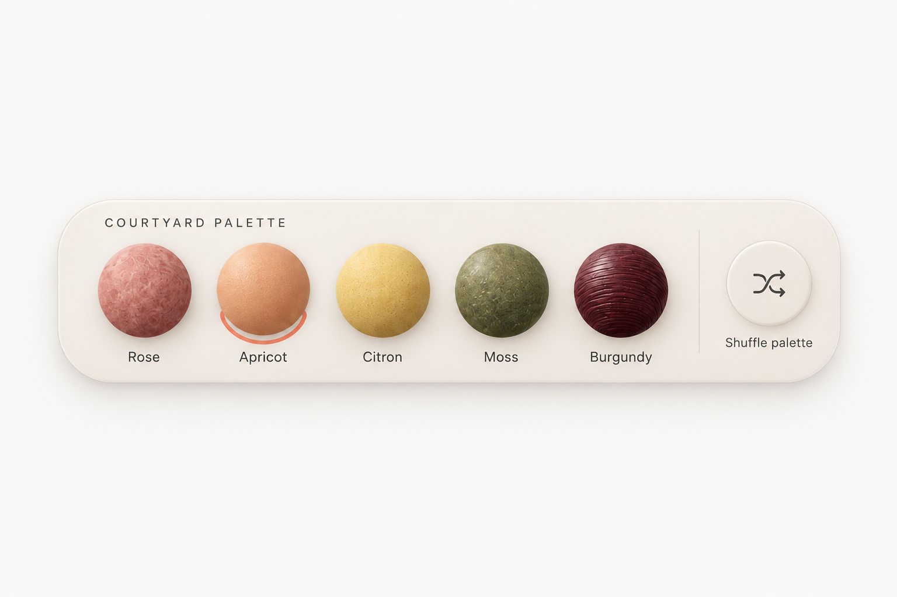

# Courtyard / Material palette picker

WDA / Jason Festa · 21 October 2026

Five material swatches and a quiet shuffle action. Make the chosen material unmistakable without turning the tray into a row of animated toys.

Long ivory porcelain tray, evenly spaced tactile spheres, one coral selection ring and small text labels. Preserve the wide, shallow footprint.

[Interactive review](courtyard.html) · [Complete control and flow ledger](../interaction/courtyard.md) · [React prompt](../prompts/interaction/courtyard.md) · [Motion brief](../prompts/motion/courtyard.md)

## 01-apricot / Apricot selected

[Exact image prompt](../prompts/states/courtyard/01-apricot.md) · [Attached visual reference](../references/originals/courtyard.png)

- **Entry:** Initial palette.
- **Visible:** Rose, Apricot, Citron, Moss and Burgundy; only Apricot has the selection ring.
- **Exit / return:** Choose any material or focus Shuffle.

- **Choose Moss** → [02-moss](#02-moss). Selection commits.
- **Focus Shuffle** → [03-focus](#03-focus). Focus only, no palette change.

## 02-moss / Moss selected

[Exact image prompt](../prompts/states/courtyard/02-moss.md) · [Attached visual reference](../images/states/courtyard/01-apricot.png)

- **Entry:** Choose Moss.
- **Visible:** The original five materials remain; only Moss is selected.
- **Exit / return:** Shuffle captures this complete palette and Moss selection.

- **Shuffle palette** → [04-shuffled](#04-shuffled). Store original set and Moss.

## 03-focus / Shuffle focused

[Exact image prompt](../prompts/states/courtyard/03-focus.md) · [Attached visual reference](../images/states/courtyard/01-apricot.png)

- **Entry:** Tab to Shuffle from the Apricot baseline without activating.
- **Visible:** Apricot remains selected; a separate high-contrast outline surrounds Shuffle.
- **Exit / return:** Tab away removes only focus; Enter shuffles the currently selected palette.

- **Return to Apricot** → [01-apricot](#01-apricot). Blur only.
- **Choose Moss before shuffle** → [02-moss](#02-moss). Makes the illustrated undo path explicit.

## 04-shuffled / New palette

[Exact image prompt](../prompts/states/courtyard/04-shuffled.md) · [Attached visual reference](../images/states/courtyard/01-apricot.png)

- **Entry:** Activate Shuffle after choosing Moss for the illustrated undo path.
- **Visible:** Clay, Peel, Brick, Plum and Ash replace the original set; Clay selected; Palette shuffled · Undo.
- **Exit / return:** Undo restores the complete prior set and Moss, not an arbitrary default.

- **Undo shuffle** → [05-restored](#05-restored). Restore original set plus Moss.

## 05-restored / Undo restores selection

[Exact image prompt](../prompts/states/courtyard/05-restored.md) · [Attached visual reference](../images/states/courtyard/01-apricot.png)

- **Entry:** Activate Undo on the shuffled set.
- **Visible:** Original materials return with Moss selected; Previous palette restored.
- **Exit / return:** Shuffle again stores a new single-level snapshot.

- **Shuffle again** → [04-shuffled](#04-shuffled). Replace previous snapshot.

## Original authority

[Original saved prompt](../prompts/originals/courtyard.md) · [Historical supplied screenshot](../references/screenshots/02-team-picker-and-palette-controls.png)

## References

- [W3C — radio group pattern](https://www.w3.org/WAI/ARIA/apg/patterns/radio/) — Courtyard keeps exactly one active material, with a visible ring and its text name.
- [Radix — Toggle Group build example](https://www.radix-ui.com/primitives/docs/components/toggle-group) — A useful implementation reference for compact controls. Courtyard still uses radio semantics because it requires a choice.
- [React — choosing state structure](https://react.dev/learn/choosing-the-state-structure) — Derive selected counts, button labels, usage totals and visible panels from stable IDs and shared data.
- [Motion — accessible animation](https://motion.dev/docs/react-accessibility) — Disable object drift, parallax and transform flourishes under reduced motion; keep selection and focus feedback.

## Supporting states

The [interaction ledger](../interaction/courtyard.md) specifies data permutations, loading, failure, cancellation, host routes and return paths beyond the five illustrated states. Earlier contextual brands are separate historical alternatives in the [archive](https://github.com/jasonfesta/WDA/raw/refs/heads/main/component-study/downloads/component-context-archive.zip).
