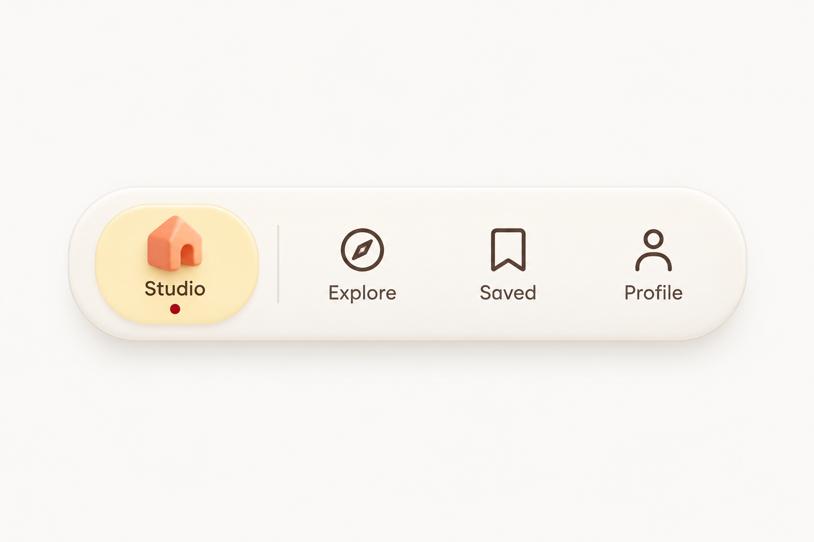

# Folio / Navigation dock

WDA / Jason Festa · 21 October 2026

A porcelain dock with one tactile accent and four clear destinations. Keep it predictable: current route, visible content and active treatment always agree.

Wide shallow ivory dock, pale citron active capsule, coral studio house, cocoa line icons and a burgundy current-state dot. Keep every destination labelled.

[Interactive review](folio.html) · [Complete control and flow ledger](../interaction/folio.md) · [React prompt](../prompts/interaction/folio.md) · [Motion brief](../prompts/motion/folio.md)

## 01-studio / Studio

[Exact image prompt](../prompts/states/folio/01-studio.md) · [Attached visual reference](../references/originals/folio.png)

- **Entry:** The host route commits /studio.
- **Visible:** Studio alone has the citron active capsule and burgundy dot.
- **Exit / return:** Follow Explore, Saved or Profile.

- **Explore** → [02-explore](#02-explore). Commit /explore.
- **Saved** → [03-saved](#03-saved). Commit /saved.
- **Profile** → [04-profile](#04-profile). Commit /profile.
- **Focus Profile only** → [05-keyboard-focus](#05-keyboard-focus). Tab without Enter.

## 02-explore / Explore

[Exact image prompt](../prompts/states/folio/02-explore.md) · [Attached visual reference](../images/states/folio/01-studio.png)

- **Entry:** The host route commits /explore.
- **Visible:** Explore alone has the active capsule and dot; icon order and dock geometry stay fixed.
- **Exit / return:** Another link changes route; browser Back restores Studio.

- **Studio** → [01-studio](#01-studio). Commit /studio.
- **Saved** → [03-saved](#03-saved). Commit /saved.
- **Profile** → [04-profile](#04-profile). Commit /profile.

## 03-saved / Saved

[Exact image prompt](../prompts/states/folio/03-saved.md) · [Attached visual reference](../images/states/folio/01-studio.png)

- **Entry:** The host route commits /saved.
- **Visible:** Saved alone is current. The host content may show saved items or an empty collection.
- **Exit / return:** Choose another destination; Browse Explore from empty content opens Explore.

- **Studio** → [01-studio](#01-studio). Commit /studio.
- **Explore** → [02-explore](#02-explore). Includes empty-state Browse Explore.
- **Profile** → [04-profile](#04-profile). Commit /profile.

## 04-profile / Profile

[Exact image prompt](../prompts/states/folio/04-profile.md) · [Attached visual reference](../images/states/folio/01-studio.png)

- **Entry:** The host route commits /profile.
- **Visible:** Profile alone is current. Account/sign-in content is owned by the host.
- **Exit / return:** Navigate away or finish/cancel sign-in while preserving returnTo=/profile.

- **Studio** → [01-studio](#01-studio). Commit /studio.
- **Explore** → [02-explore](#02-explore). Commit /explore.
- **Saved** → [03-saved](#03-saved). Commit /saved.

## 05-keyboard-focus / Focus without navigation

[Exact image prompt](../prompts/states/folio/05-keyboard-focus.md) · [Attached visual reference](../images/states/folio/01-studio.png)

- **Entry:** While Studio is current, Tab through the links until Profile has focus.
- **Visible:** Studio keeps the only active capsule and dot; Profile has an outline only.
- **Exit / return:** Enter follows Profile; Tab away moves focus without navigation.

- **Enter follows Profile** → [04-profile](#04-profile). Commit before moving current marker.
- **Blur without navigating** → [01-studio](#01-studio). Studio stays current.

## Original authority

[Original saved prompt](../prompts/originals/folio.md) · [Historical supplied screenshot](../references/screenshots/05-navigation-dock.png)

## References

- [MDN — aria-current](https://developer.mozilla.org/en-US/docs/Web/Accessibility/ARIA/Reference/Attributes/aria-current) — Folio uses navigation links and aria-current="page" for routes. Use tabs only if switching local panels.
- [W3C — tabs pattern](https://www.w3.org/WAI/ARIA/apg/patterns/tabs/) — Sol day selection, Roam plan previews and Kiln reporting periods use one active panel. Focus and selection are tracked separately.
- [React — choosing state structure](https://react.dev/learn/choosing-the-state-structure) — Derive selected counts, button labels, usage totals and visible panels from stable IDs and shared data.
- [Motion — accessible animation](https://motion.dev/docs/react-accessibility) — Disable object drift, parallax and transform flourishes under reduced motion; keep selection and focus feedback.

## Supporting states

The [interaction ledger](../interaction/folio.md) specifies data permutations, loading, failure, cancellation, host routes and return paths beyond the five illustrated states. Earlier contextual brands are separate historical alternatives in the [archive](https://github.com/jasonfesta/WDA/raw/refs/heads/main/component-study/downloads/component-context-archive.zip).
