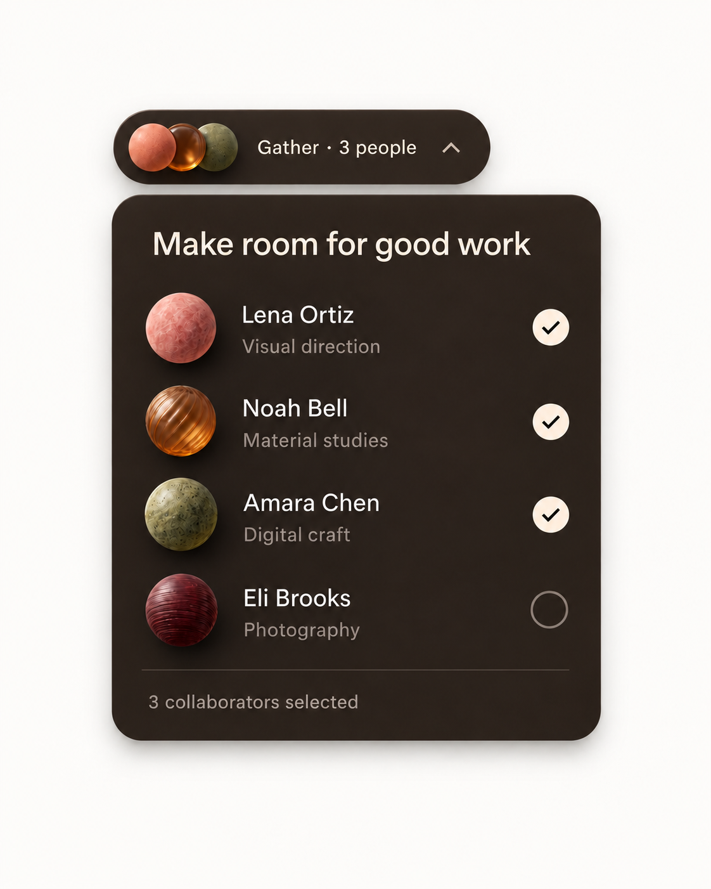
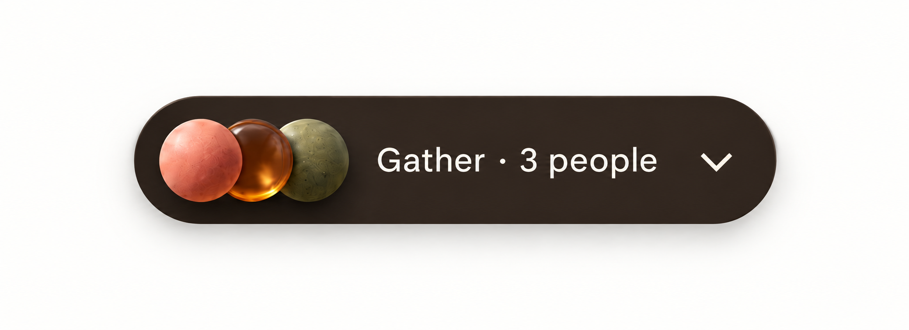
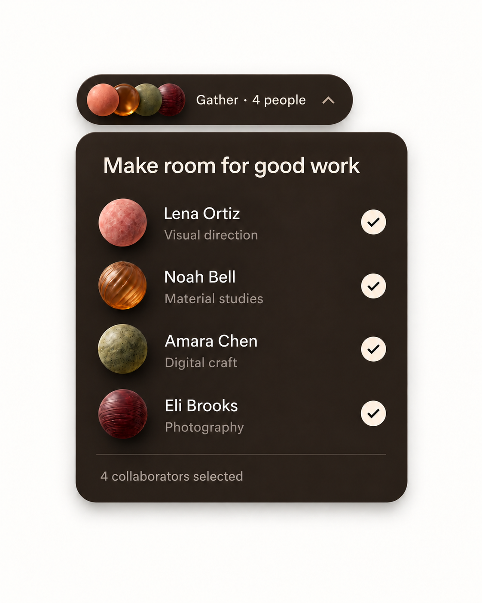
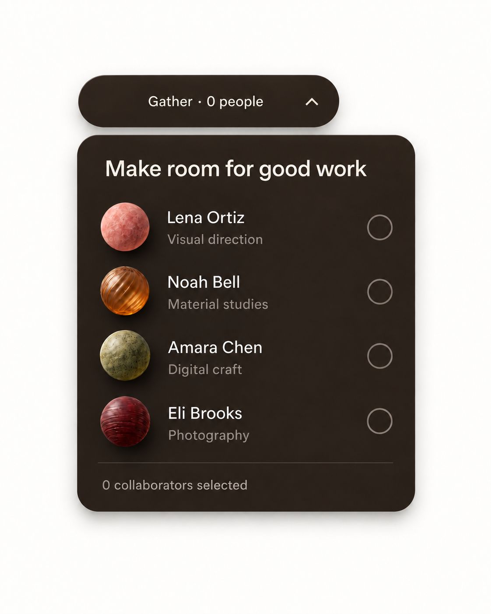
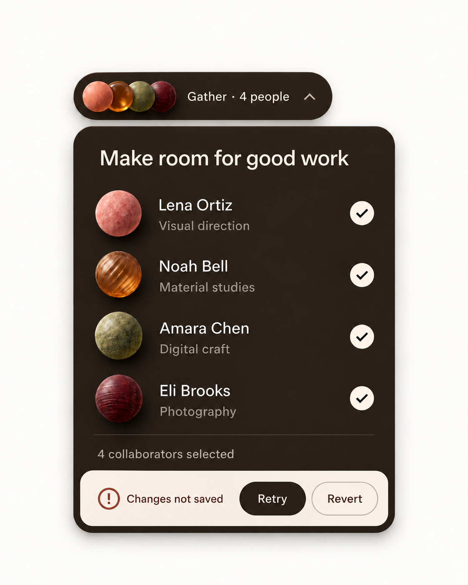

# Gather / Team picker

WDA / Jason Festa · 21 October 2026

A small selection tool with a rich material personality. Its warmth comes from four tactile avatars and a dark cocoa surface, with clear selection feedback.

Cocoa panel, cream checkmarks and rose, amber, moss and burgundy objects. Keep the floating trigger connected to the list and preserve generous row spacing.

[Interactive review](gather.html) · [Complete control and flow ledger](../interaction/gather.md) · [React prompt](../prompts/interaction/gather.md) · [Motion brief](../prompts/motion/gather.md)

## 01-three-selected / Three selected

[Exact image prompt](../prompts/states/gather/01-three-selected.md) · [Attached visual reference](../references/originals/gather.png)

- **Entry:** Open the picker with the saved three-person set.
- **Visible:** Lena, Noah and Amara checked; three corresponding avatars and a count of 3.
- **Exit / return:** Toggle any checkbox or close.

- **Close picker** → [02-closed](#02-closed). Selected IDs persist.
- **Select Eli** → [03-four-selected](#03-four-selected). Count and all avatars derive from IDs.

## 02-closed / Closed picker

[Exact image prompt](../prompts/states/gather/02-closed.md) · [Attached visual reference](../images/states/gather/01-three-selected.png)

- **Entry:** Close the three-person picker using trigger, Escape or outside click.
- **Visible:** Only the trigger remains; three avatars, Gather · 3 people and a down chevron.
- **Exit / return:** Reopen restores the same selected IDs.

- **Open picker** → [01-three-selected](#01-three-selected). Restore three checked rows.

## 03-four-selected / Four selected

[Exact image prompt](../prompts/states/gather/03-four-selected.md) · [Attached visual reference](../images/states/gather/01-three-selected.png)

- **Entry:** Select Eli from the three-person set.
- **Visible:** All four rows checked; four matching avatars; both summaries say 4.
- **Exit / return:** Deselect rows, close or handle save failure.

- **Deselect Eli** → [01-three-selected](#01-three-selected). Return to the saved three-person set.
- **Deselect all four** → [04-empty](#04-empty). Review shortcut for four individual checkbox actions; no Clear all button is drawn.
- **Save fails** → [05-save-error](#05-save-error). Keep attempted four-person selection.

## 04-empty / Zero selected

[Exact image prompt](../prompts/states/gather/04-empty.md) · [Attached visual reference](../images/states/gather/01-three-selected.png)

- **Entry:** Deselect all four people.
- **Visible:** All checkboxes empty; no trigger avatars; both summaries say 0.
- **Exit / return:** Select any row; the count and avatars return from the selected IDs.

- **Select Lena, Noah and Amara** → [01-three-selected](#01-three-selected). Review shortcut for three individual toggles; not one hidden UI action.

## 05-save-error / Selection save error

[Exact image prompt](../prompts/states/gather/05-save-error.md) · [Attached visual reference](../images/states/gather/01-three-selected.png)

- **Entry:** Saving the attempted four-person set fails.
- **Visible:** Four remain checked; Changes not saved, Retry and Revert appear beneath the summary.
- **Exit / return:** Retry success reaches the four-person state; Revert restores the saved three-person set.

- **Retry succeeds** → [03-four-selected](#03-four-selected). Confirm the attempted four IDs.
- **Revert** → [01-three-selected](#01-three-selected). Restore last-confirmed IDs.
- **Retry fails** → [05-save-error](#05-save-error). Retain the error.

## Original authority

[Original saved prompt](../prompts/originals/gather.md) · [Historical supplied screenshot](../references/screenshots/02-team-picker-and-palette-controls.png)

## References

- [W3C — checkbox pattern](https://www.w3.org/WAI/ARIA/apg/patterns/checkbox/) — Gather uses one native checkbox per person, with count and avatar summary derived from selected IDs.
- [W3C — disclosure pattern](https://www.w3.org/WAI/ARIA/apg/patterns/disclosure/) — Gather opens by activation, not hover; its trigger communicates open or closed.
- [Radix — Popover build example](https://www.radix-ui.com/primitives/docs/components/popover) — Use a tested popover primitive for Gather and Sol options, retaining the existing material art and layout.
- [React — choosing state structure](https://react.dev/learn/choosing-the-state-structure) — Derive selected counts, button labels, usage totals and visible panels from stable IDs and shared data.
- [Motion — accessible animation](https://motion.dev/docs/react-accessibility) — Disable object drift, parallax and transform flourishes under reduced motion; keep selection and focus feedback.

## Supporting states

The [interaction ledger](../interaction/gather.md) specifies data permutations, loading, failure, cancellation, host routes and return paths beyond the five illustrated states. Earlier contextual brands are separate historical alternatives in the [archive](https://github.com/jasonfesta/WDA/raw/refs/heads/main/component-study/downloads/component-context-archive.zip).
