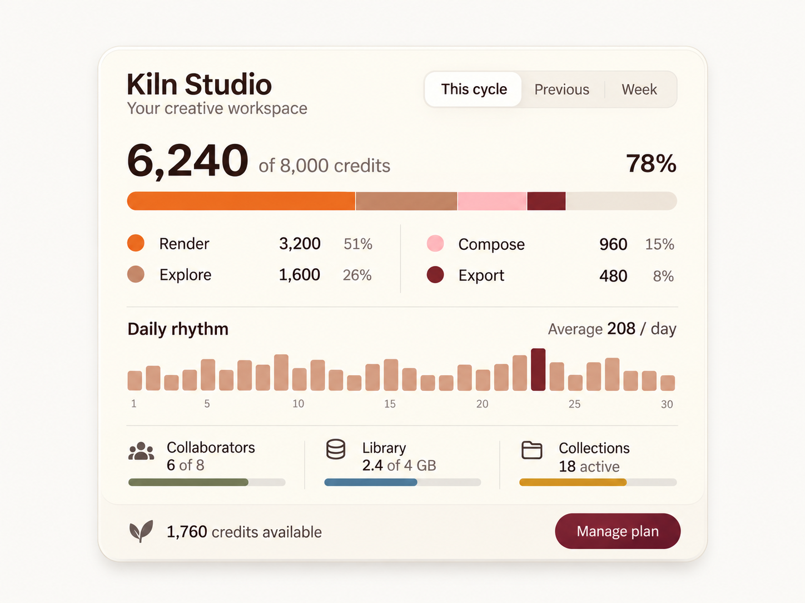

# Kiln / Usage dashboard

WDA / Jason Festa · 21 October 2026

A calm account overview where warm colour helps explain capacity. Data should lead every bar, count and interaction, with a readable path to detail.

Wide cream panel, cocoa labels, orange/rose/burgundy category segments, a simple daily rhythm and a compact resource footer. Keep bars mathematically honest.

[Interactive review](kiln.html) · [Complete control and flow ledger](../interaction/kiln.md) · [React prompt](../prompts/interaction/kiln.md) · [Motion brief](../prompts/motion/kiln.md)

## 01-cycle / This cycle

[Exact image prompt](../prompts/states/kiln/01-cycle.md) · [Attached visual reference](../references/originals/kiln.png)

- **Entry:** Load the confirmed current 30-day cycle.
- **Visible:** 6,240/8,000 (78%), categories 3,200/1,600/960/480, average 208/day; 1,760 available.
- **Exit / return:** Switch period, inspect a category or manage the plan.

- **Previous cycle** → [02-previous](#02-previous). Load a coherent dataset.
- **This week** → [03-week](#03-week). Load seven-day fixture.
- **Inspect Render** → [04-detail](#04-detail). Keep cycle totals visible.
- **Manage plan** → [05-manage](#05-manage). No charge.

## 02-previous / Previous cycle

[Exact image prompt](../prompts/states/kiln/02-previous.md) · [Attached visual reference](../images/states/kiln/01-cycle.png)

- **Entry:** Activate Previous and resolve its whole dataset.
- **Visible:** 4,800/8,000 (60%); categories 2,400/1,200/720/480; average 160/day; 3,200 available.
- **Exit / return:** Return to This cycle or choose Week.

- **This cycle** → [01-cycle](#01-cycle). Restore the current cycle.
- **This week** → [03-week](#03-week). Load seven-day fixture.

## 03-week / This week

[Exact image prompt](../prompts/states/kiln/03-week.md) · [Attached visual reference](../images/states/kiln/01-cycle.png)

- **Entry:** Activate Week and resolve its seven-day dataset.
- **Visible:** 1,400/8,000 (17.5%); 700/350/210/140; average 200/day; seven weekday bars. The 6,600 difference is against the allowance, not remaining balance this cycle.
- **Exit / return:** Switch period or inspect a day; the resource snapshots remain account-wide.

- **This cycle** → [01-cycle](#01-cycle). Return to actual remaining cycle balance.
- **Previous cycle** → [02-previous](#02-previous). Switch whole dataset.

## 04-detail / Inspect Render usage

[Exact image prompt](../prompts/states/kiln/04-detail.md) · [Attached visual reference](../images/states/kiln/01-cycle.png)

- **Entry:** Activate Render from This cycle.
- **Visible:** Render popover: 3,200 credits; 51% of used credits; 40% of cycle allowance; View render activity and Close.
- **Exit / return:** Close returns focus to Render; View render activity opens a filtered host detail view.

- **Close detail** → [01-cycle](#01-cycle). Restore focus to Render.

## 05-manage / Manage plan

[Exact image prompt](../prompts/states/kiln/05-manage.md) · [Attached visual reference](../images/states/kiln/01-cycle.png)

- **Entry:** Activate Manage plan from This cycle.
- **Visible:** Current plan dialog: 8,000 allowance, 6,240 used, 1,760 available, 6/8 seats and 2.4/4 GB; Compare plans, Back to usage, Close.
- **Exit / return:** Back/Close returns to the same cycle; Compare plans opens the host’s verified catalogue.

- **Back to usage** → [01-cycle](#01-cycle). Restore focus to Manage plan.

## Original authority

[Original saved prompt](../prompts/originals/kiln.md) · [Historical supplied screenshot](../references/screenshots/04-usage-dashboard.png)

## References

- [Supabase — usage documentation](https://supabase.com/docs/guides/platform/manage-your-usage) — Kiln needs explicit units, denominator labels and category details. This is a structure reference, not a copied pricing model.
- [W3C — complex images and charts](https://www.w3.org/WAI/tutorials/images/complex/) — Kiln exposes a data table and values in text; hover tooltips are supplemental.
- [W3C — tabs pattern](https://www.w3.org/WAI/ARIA/apg/patterns/tabs/) — Sol day selection, Roam plan previews and Kiln reporting periods use one active panel. Focus and selection are tracked separately.
- [W3C — modal dialog pattern](https://www.w3.org/WAI/ARIA/apg/patterns/dialog-modal/) — Roam review and Kiln plan details need explicit close/cancel paths with trigger focus restoration.
- [React — choosing state structure](https://react.dev/learn/choosing-the-state-structure) — Derive selected counts, button labels, usage totals and visible panels from stable IDs and shared data.

## Supporting states

The [interaction ledger](../interaction/kiln.md) specifies data permutations, loading, failure, cancellation, host routes and return paths beyond the five illustrated states. Earlier contextual brands are separate historical alternatives in the [archive](https://github.com/jasonfesta/WDA/raw/refs/heads/main/component-study/downloads/component-context-archive.zip).
