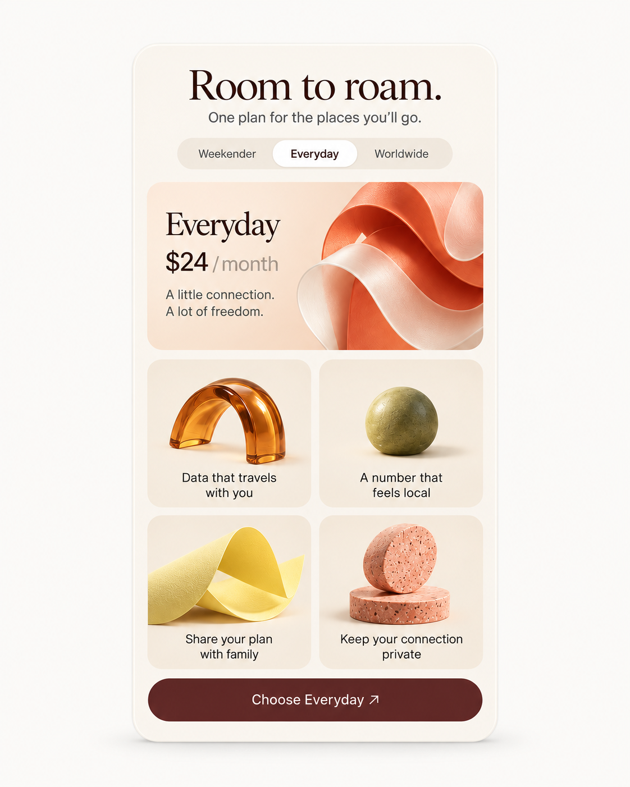

# Roam / Membership panel

WDA / Jason Festa · 21 October 2026

An editorial membership card with a clear decision at its centre. Keep the ribbon and sculptural feature objects expressive while the plan and price remain authoritative.

Tall ivory panel, serif headline, coral ribbon, warm feature cells and a burgundy CTA. Give plan changes space; the whole panel should not jump in height.

[Interactive review](roam.html) · [Complete control and flow ledger](../interaction/roam.md) · [React prompt](../prompts/interaction/roam.md) · [Motion brief](../prompts/motion/roam.md)

## 01-everyday / Everyday plan

[Exact image prompt](../prompts/states/roam/01-everyday.md) · [Attached visual reference](../references/originals/roam.png)

- **Entry:** Initial plan preview.
- **Visible:** Everyday selected; $24/month and its four original benefits.
- **Exit / return:** Choose another plan or review Everyday.

- **Preview Weekender** → [02-weekender](#02-weekender). Proposed $12 fixture.
- **Preview Worldwide** → [03-worldwide](#03-worldwide). Proposed $48 fixture.
- **Choose Everyday** → [04-review](#04-review). Opens review; no charge.

## 02-weekender / Weekender plan

[Exact image prompt](../prompts/states/roam/02-weekender.md) · [Attached visual reference](../images/states/roam/01-everyday.png)

- **Entry:** Activate Weekender.
- **Visible:** Weekender, $12/month; Weekend travel data, One local number, Your personal plan, A private connection; matching CTA.
- **Exit / return:** Switch plans or review this plan using its own fixture data.

- **Preview Everyday** → [01-everyday](#01-everyday). Restore $24 fixture.
- **Preview Worldwide** → [03-worldwide](#03-worldwide). Plan fields change together.

## 03-worldwide / Worldwide plan

[Exact image prompt](../prompts/states/roam/03-worldwide.md) · [Attached visual reference](../images/states/roam/01-everyday.png)

- **Entry:** Activate Worldwide.
- **Visible:** Worldwide, $48/month; Data across borders, Local-number options, Share with four people, A private connection; matching CTA.
- **Exit / return:** Switch plans or review the selected plan.

- **Preview Everyday** → [01-everyday](#01-everyday). Restore $24 fixture.
- **Preview Weekender** → [02-weekender](#02-weekender). Plan fields change together.

## 04-review / Review chosen plan

[Exact image prompt](../prompts/states/roam/04-review.md) · [Attached visual reference](../images/states/roam/01-everyday.png)

- **Entry:** Choose Everyday from its preview.
- **Visible:** Review your plan dialog; Everyday, $24/month, Billed monthly; Continue to checkout, Back to plans, Close.
- **Exit / return:** Back/Close cancels; Continue requests a checkout session. Confirmation requires verified completion.

- **Back to plans** → [01-everyday](#01-everyday). No purchase.
- **Verified checkout completes** → [05-confirmed](#05-confirmed). Review simulation: host checkout must finish before showing this screen.

## 05-confirmed / Confirmation

[Exact image prompt](../prompts/states/roam/05-confirmed.md) · [Attached visual reference](../images/states/roam/01-everyday.png)

- **Entry:** The host reports verified Everyday checkout completion.
- **Visible:** You’re ready to roam; Everyday $24/month; Manage membership and Back to plans.
- **Exit / return:** Manage opens the membership account; Back returns to plan comparison without cancelling membership.

- **Back to plans** → [01-everyday](#01-everyday). Keeps the completed membership.

## Original authority

[Original saved prompt](../prompts/originals/roam.md) · [Historical supplied screenshot](../references/screenshots/03-membership-panel.png)

## References

- [W3C — tabs pattern](https://www.w3.org/WAI/ARIA/apg/patterns/tabs/) — Sol day selection, Roam plan previews and Kiln reporting periods use one active panel. Focus and selection are tracked separately.
- [Stripe — subscription pricing table](https://docs.stripe.com/payments/checkout/pricing-table) — Roam previews and compares plans, then explicitly reviews the chosen price. Selection alone does not subscribe.
- [W3C — modal dialog pattern](https://www.w3.org/WAI/ARIA/apg/patterns/dialog-modal/) — Roam review and Kiln plan details need explicit close/cancel paths with trigger focus restoration.
- [React — choosing state structure](https://react.dev/learn/choosing-the-state-structure) — Derive selected counts, button labels, usage totals and visible panels from stable IDs and shared data.
- [Motion — accessible animation](https://motion.dev/docs/react-accessibility) — Disable object drift, parallax and transform flourishes under reduced motion; keep selection and focus feedback.

## Supporting states

The [interaction ledger](../interaction/roam.md) specifies data permutations, loading, failure, cancellation, host routes and return paths beyond the five illustrated states. Earlier contextual brands are separate historical alternatives in the [archive](https://github.com/jasonfesta/WDA/raw/refs/heads/main/component-study/downloads/component-context-archive.zip).
