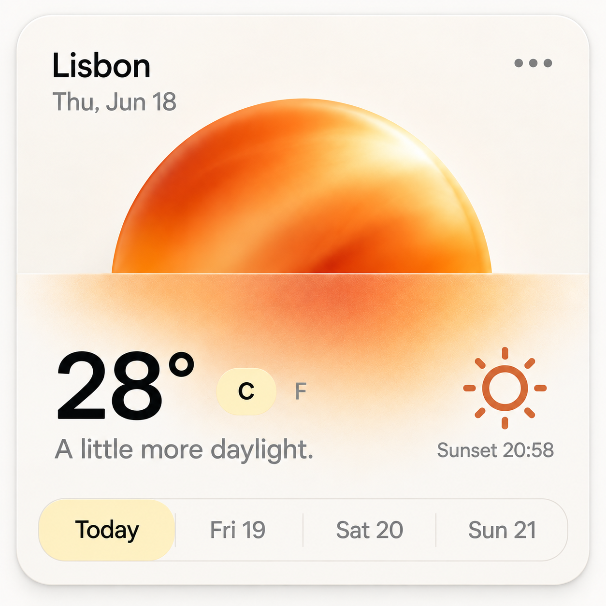
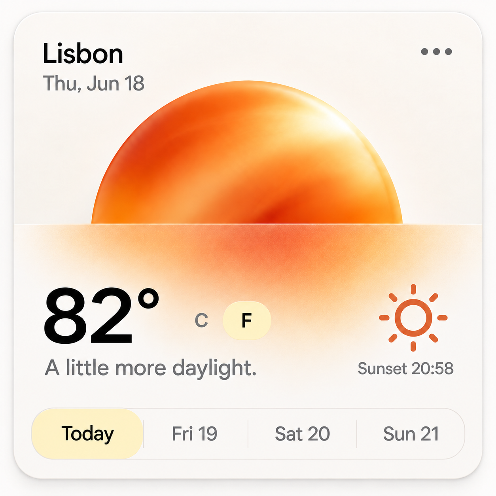
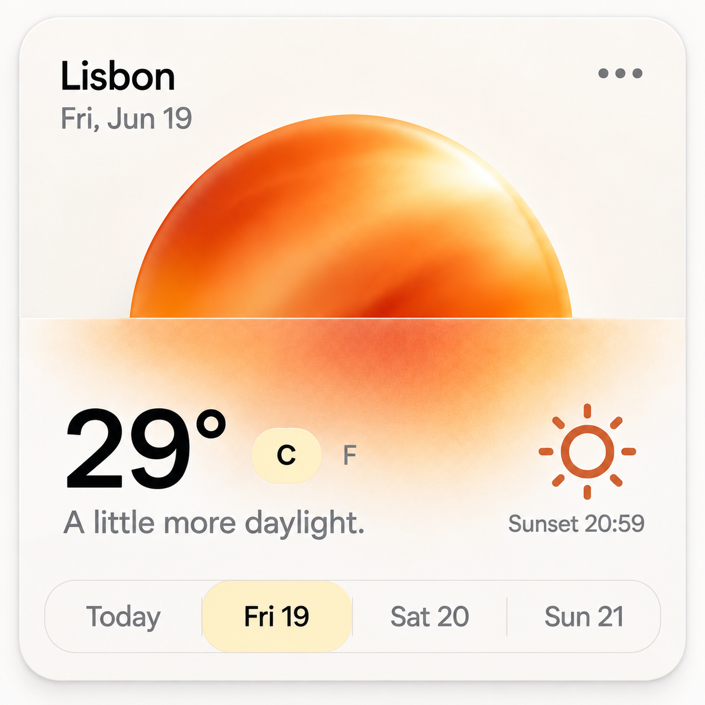
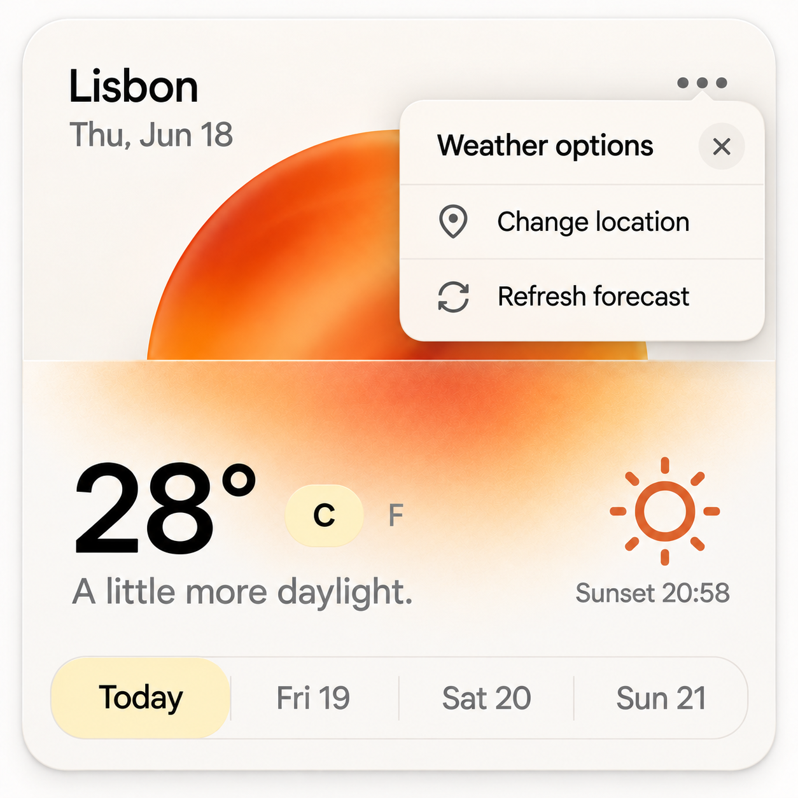
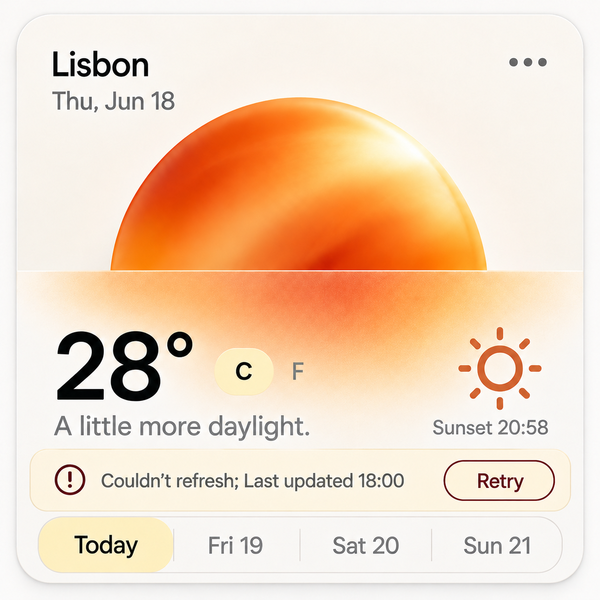
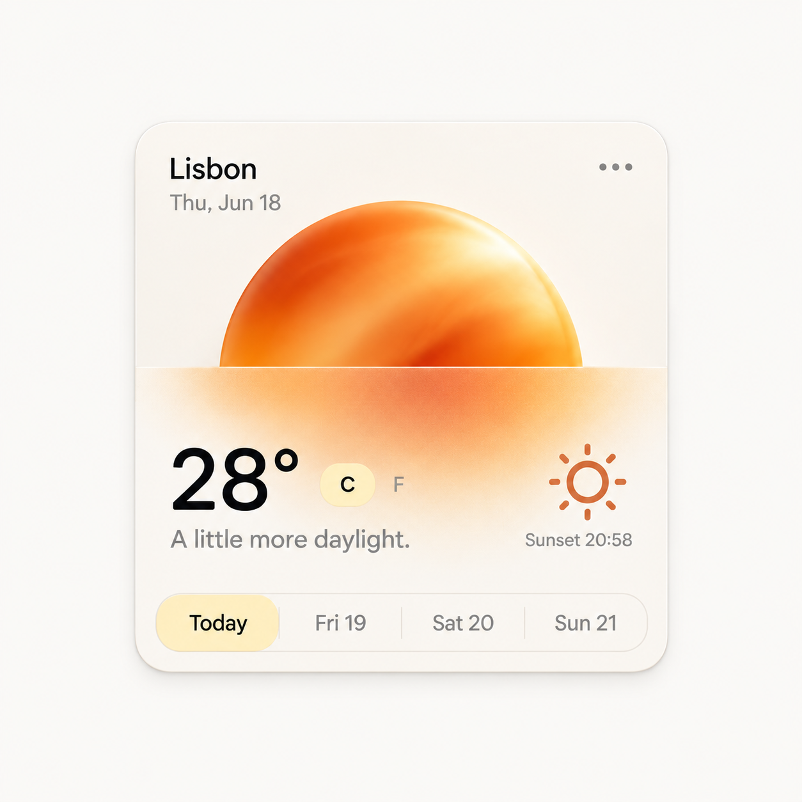

# Sol / Weather card

WDA / Jason Festa · 21 October 2026

A warm, compact forecast built around a satin sun and a frosted horizon. Keep the weather legible while the atmosphere stays quiet.

Ivory shell, orange satin disc, frosted lower plane, citron selected controls and charcoal type. The disc stays behind the data; labels never become part of a shader.

[Interactive review](sol.html) · [Complete control and flow ledger](../interaction/sol.md) · [React prompt](../prompts/interaction/sol.md) · [Motion brief](../prompts/motion/sol.md)

## 01-today / Today · Celsius

[Exact image prompt](../prompts/states/sol/01-today.md) · [Attached visual reference](../references/originals/sol.png)

- **Entry:** Initial successful forecast for Lisbon.
- **Visible:** 28°C, Today active, Thu Jun 18 and sunset 20:58.
- **Exit / return:** Change unit, select a day or open More.

- **Use Fahrenheit** → [02-fahrenheit](#02-fahrenheit). Client-side conversion.
- **Friday forecast** → [03-friday](#03-friday). Update all date-specific fields.
- **Open options** → [04-options](#04-options). Focus the first action.

## 02-fahrenheit / Today · Fahrenheit

[Exact image prompt](../prompts/states/sol/02-fahrenheit.md) · [Attached visual reference](../images/states/sol/01-today.png)

- **Entry:** Activate F from Today.
- **Visible:** 82°F, F active; date, day and sunset unchanged.
- **Exit / return:** C returns to 28°C with no request.

- **Use Celsius** → [01-today](#01-today). No network request.

## 03-friday / Friday forecast

[Exact image prompt](../prompts/states/sol/03-friday.md) · [Attached visual reference](../images/states/sol/01-today.png)

- **Entry:** Activate Fri 19 from the Celsius baseline.
- **Visible:** 29°C; Fri Jun 19 and Fri 19 active; sunset 20:59.
- **Exit / return:** Today restores its date, temperature and sunset.

- **Return to Today** → [01-today](#01-today). Restore Today data.

## 04-options / Options open

[Exact image prompt](../prompts/states/sol/04-options.md) · [Attached visual reference](../images/states/sol/01-today.png)

- **Entry:** Activate the three-dot More button.
- **Visible:** Weather options popover: Change location, Refresh forecast and Close.
- **Exit / return:** Close/Escape restores focus; Refresh either succeeds or enters the retry state.

- **Close options** → [01-today](#01-today). Return focus to More.
- **Refresh fails** → [05-retry](#05-retry). Simulated failure with cached data.

## 05-retry / Stale forecast · Retry

[Exact image prompt](../prompts/states/sol/05-retry.md) · [Attached visual reference](../images/states/sol/01-today.png)

- **Entry:** Refresh fails with a cached forecast.
- **Visible:** Retain Today 28°C; Couldn’t refresh; Last updated 18:00; Retry.
- **Exit / return:** Retry success restores Today; repeated failure keeps a usable retry action.

- **Retry succeeds** → [01-today](#01-today). Replace cache only after success.
- **Retry fails** → [05-retry](#05-retry). Keep timestamp and error.

## Original authority

[Original saved prompt](../prompts/originals/sol.md) · [Historical supplied screenshot](../references/screenshots/01-weather-card.png)

## References

- [Apple — Weather guide](https://support.apple.com/guide/iphone/check-the-weather-iph1ac0b35f/ios) — Sol retains a compact four-day surface, with unit conversion and a separately opened location control.
- [W3C — tabs pattern](https://www.w3.org/WAI/ARIA/apg/patterns/tabs/) — Sol day selection, Roam plan previews and Kiln reporting periods use one active panel. Focus and selection are tracked separately.
- [Radix — Popover build example](https://www.radix-ui.com/primitives/docs/components/popover) — Use a tested popover primitive for Gather and Sol options, retaining the existing material art and layout.
- [React — choosing state structure](https://react.dev/learn/choosing-the-state-structure) — Derive selected counts, button labels, usage totals and visible panels from stable IDs and shared data.
- [Motion — accessible animation](https://motion.dev/docs/react-accessibility) — Disable object drift, parallax and transform flourishes under reduced motion; keep selection and focus feedback.

## Supporting states

The [interaction ledger](../interaction/sol.md) specifies data permutations, loading, failure, cancellation, host routes and return paths beyond the five illustrated states. Earlier contextual brands are separate historical alternatives in the [archive](https://github.com/jasonfesta/WDA/raw/refs/heads/main/component-study/downloads/component-context-archive.zip).
