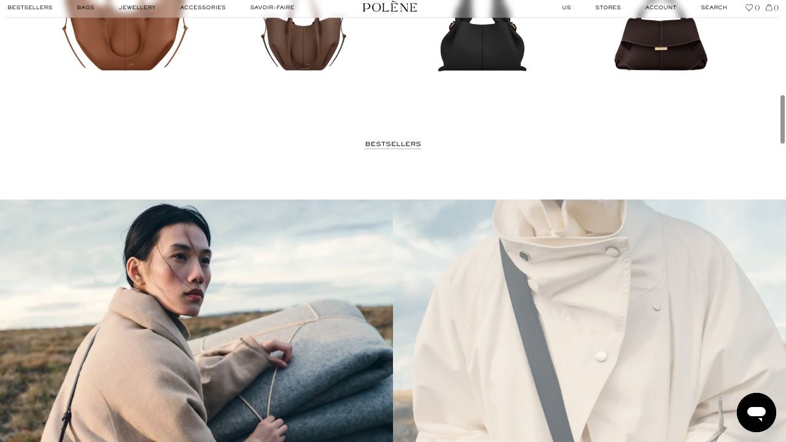
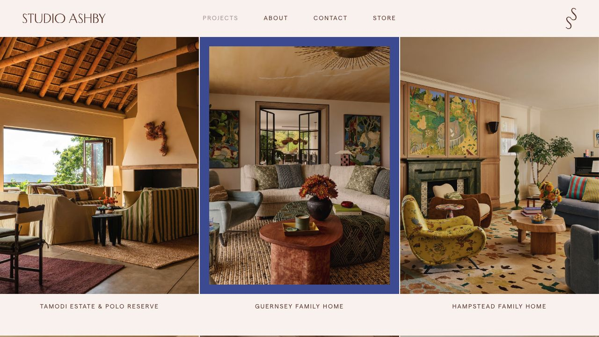
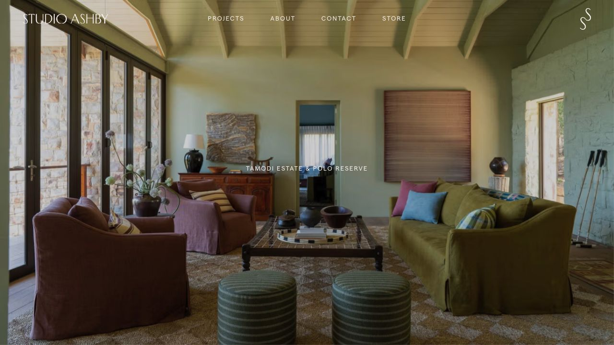
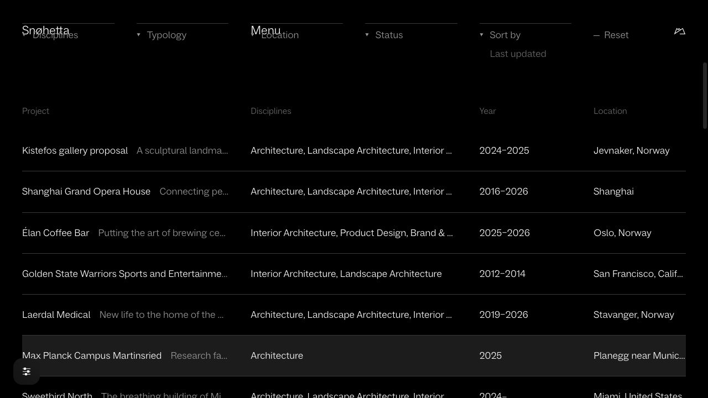
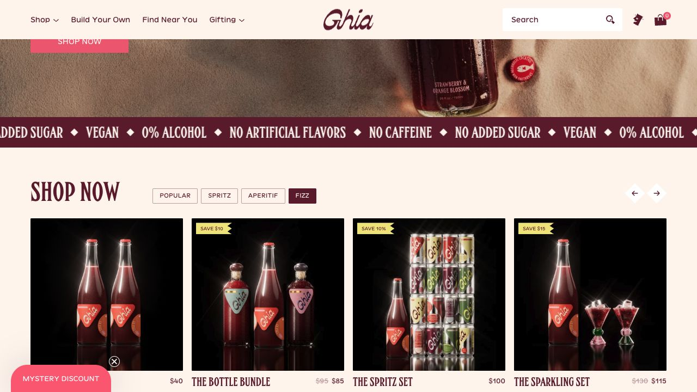
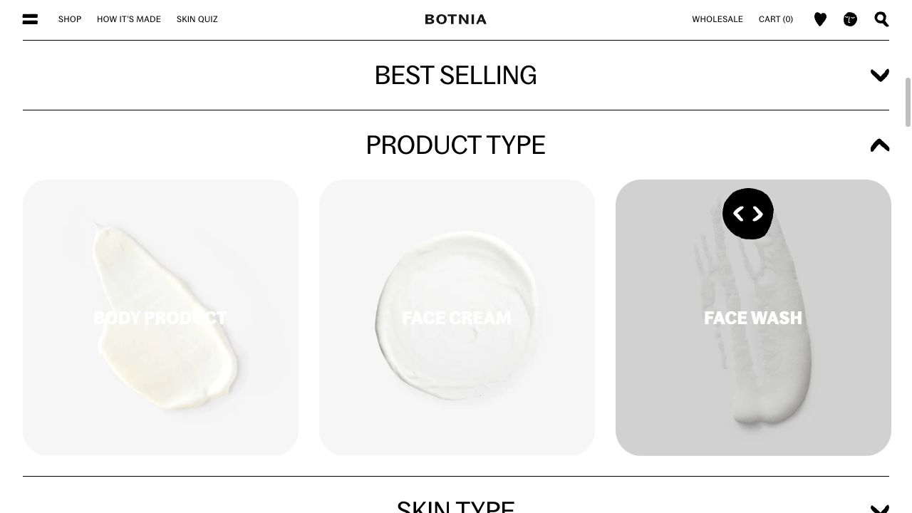

# Live build reference register

Inspected 21 October 2026. Timings and hover treatments in the WDA specifications are proposals. Screenshots are review evidence, not production imagery. See also the [first-pass 25-site research](desktop.html).

## Polène — homepage

[Open source](https://eng.polene-paris.com/)

**Evidence:** Browser scroll + DOM.

Product silhouettes sit above a wide pause and paired editorial photographs. Product links and separate quick-add controls are present. Hover animation was not tested.

## Hereu — Craftsmanship

[Open source](https://hereustudio.com/pages/craftmanship)

**Evidence:** Primary-page content.

Craft narrative provides a dedicated destination for maker and material stories; interaction timing was not observed.

## Polène — Materials

[Open source](https://eng.polene-paris.com/blogs/bags/materials)

**Evidence:** Primary-page content.

A dedicated material story is distinct from the product index.

## Polène — Manufacturing

[Open source](https://eng.polene-paris.com/blogs/bags/manufacturing)

**Evidence:** Primary-page content.

Making has a separate editorial destination.

## Studio Ashby — Projects

[Open source](https://studioashby.com/projects/)

**Evidence:** Browser scroll, screenshot and click.

Unboxed photographs carry small project captions. The Tamodi tile navigated to a dedicated full-image case study.

## Studio Ashby — Tamodi Estate

[Open source](https://studioashby.com/project/tamodi-estate/)

**Evidence:** Browser navigation + DOM.

Full-viewport photograph leads into image pairs, a narrative, linked furniture and a next-project control.

## Workstead — Studio and lighting

[Open source](https://workstead.com/)

**Evidence:** Primary-page content.

Interiors and lighting have distinct paths; finish samples and studio inquiry support the design offering.

## Workstead — Project inquiry

[Open source](https://workstead.com/project-inquiry/)

**Evidence:** Primary-page content; no submission.

Inquiry asks for project type, location, timeline and description. Newsletter interests are separately represented.

## Snøhetta — Project index

[Open source](https://www.snohetta.com/projects?view=list&sortBy=last-updated)

**Evidence:** Browser click + URL + DOM.

Selecting List changed the grid to a table and reflected view/list and sort state in the URL. Rows expose discipline, year and location.

## Olson Kundig — Design approach

[Open source](https://olsonkundig.com/design-approach/)

**Evidence:** Primary-page content.

People/place, making and field stories connect practice to built work. A motion preference control exists; its animation behavior was not tested.

## Ghia — Homepage shop module

[Open source](https://drinkghia.com/)

**Evidence:** Browser click + selected panel + screenshot.

After dismissing a signup overlay, selecting Fizz replaced the Popular panel with five Fizz entries. Product detail links, previous/next controls and editorial commerce modules are present.

## Pentire — Serves

[Open source](https://pentiredrinks.com/blogs/serves)

**Evidence:** Primary-page content.

Named serving articles lead from recipe discovery to individual serves.

## Pentire — Community

[Open source](https://pentiredrinks.com/blogs/news)

**Evidence:** Primary-page content.

Hosting, food, people and place are treated as individual editorial stories.

## Botnia — Homepage

[Open source](https://www.botniaskincare.com/)

**Evidence:** Browser category click + DOM + screenshot.

Selecting Product type replaced the bestseller items with body, cream and wash categories. A batch lookup, product routes, journal, ingredient routes and newsletter are also present.

## Botnia — Key ingredients

[Open source](https://www.botniaskincare.com/blogs/key-ingredients)

**Evidence:** Primary-page content.

Botanical information is organized as a browsable ingredient journal.

## Botnia — Find your skincare routine

[Open source](https://www.botniaskincare.com/pages/find-your-skincare-routine)

**Evidence:** Primary-page content; no form submission.

The routine has a dedicated advice pathway. Do not borrow clinical or personalized-advice claims for Serein.

## Vintner’s Daughter — Products and stories

[Open source](https://vintnersdaughter.com/)

**Evidence:** Primary-page content.

A focused range assigns routine roles to products and links to source and philosophy stories.

## Inspection limits

Pointer hover was not directly tested. Captures verify composition and the recorded click changes, not source code or exact timing. Newsletter overlays on Studio Ashby and Ghia were dismissed without submission. No purchase, signup or inquiry was submitted. Workstead, Hereu, Olson Kundig, Pentire and Vintner’s Daughter are content references rather than complete interactive audits in this pass. Product, formulation and project claims belong to their source brands.
