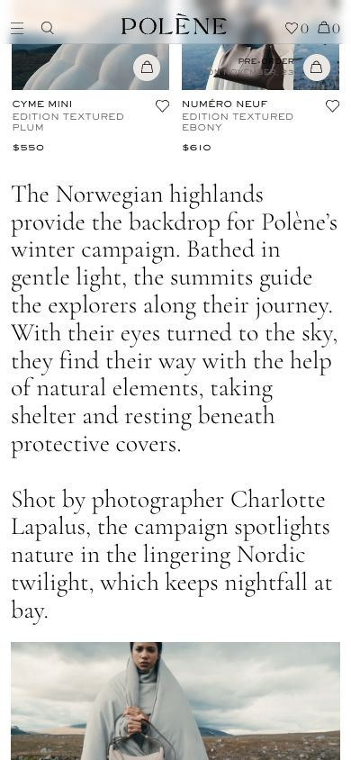
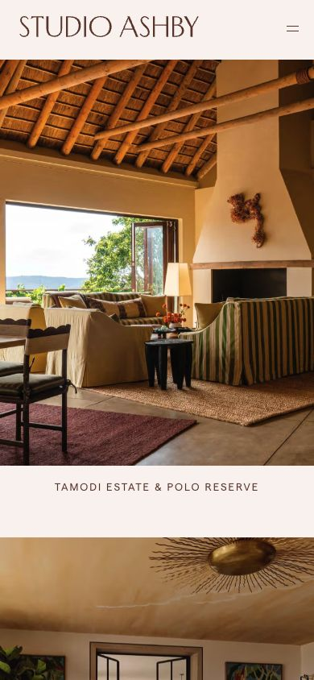
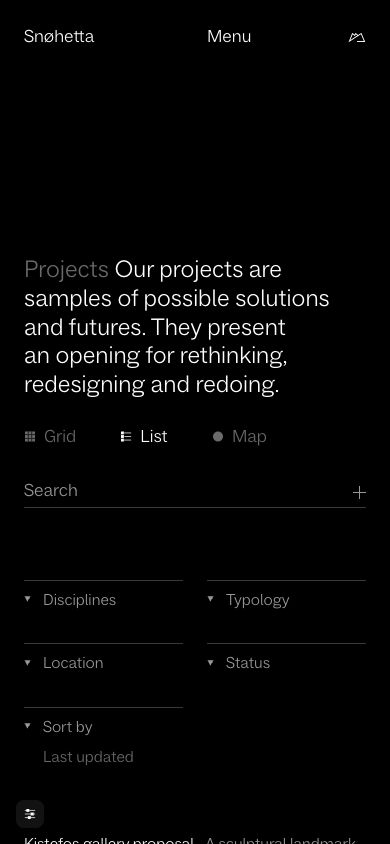
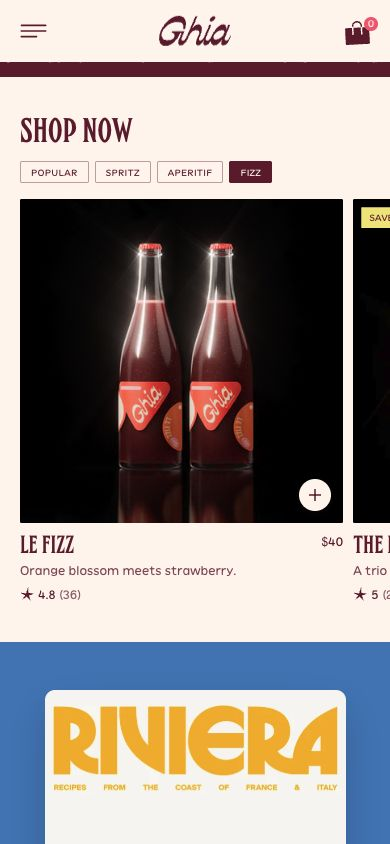
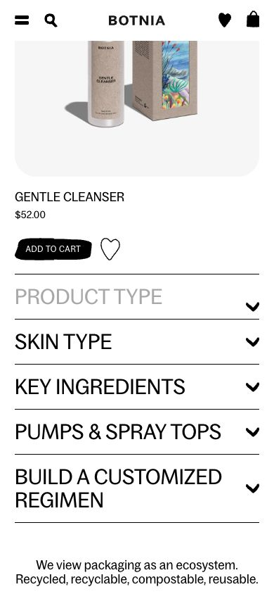

# Mobile reference research

21 October 2026 · browser viewport 390 × 844 CSS pixels. Five category references were inspected at phone width. These are responsive-browser observations, not physical iOS/Android tests. Proposed WDA behaviors are distinguished below.

## Polène — mobile homepage

[Open live reference](https://eng.polene-paris.com/)

**Observed:** At 390 × 844, the header uses a compact menu and persistent brand/cart controls. Product cards form two columns with names and prices beneath; a large serif editorial passage follows. The cookie notice was dismissed. This is a viewport-width inspection, not a physical-device test.

**Applied to WDA:** Retain visible product labels, a compact header and generous story typography. Avela gives its signature Arc more prominence, then uses two secondary products.

## Studio Ashby — mobile projects

[Open live reference](https://studioashby.com/projects/)

**Observed:** At 390 × 844, projects form one vertical sequence of large photographs with persistent captions below. The header shows the wordmark and menu icon. Activating Tamodi Estate opened its case-study page; the case-study content was inspected.

**Applied to WDA:** Room & Ritual keeps project names outside images and opens each home with one tap. Large photographs carry the narrative; a third project can remain a text link.

## Snøhetta — mobile project index

[Open live reference](https://www.snohetta.com/projects?view=list&sortBy=last-updated)

**Observed:** At 390 × 844, the project introduction wraps above Grid / List / Map controls, search and two-column filter disclosures. List remained selected. Activating Filter projects updated the results and added a result count and Reset filter link. This was not an audit of every filter option.

**Applied to WDA:** Oriel retains explicit All / Culture / Living controls above its project content. The proposed three-filter interface is simpler than the reference; selection is visible and stored in the URL.

## Ghia — mobile product categories

[Open live reference](https://drinkghia.com/)

**Observed:** At 390 × 844, a portrait hero is followed by category tabs and a large product tile with a sliver of the next tile visible. Activating Fizz selected it and displayed Le Fizz products. No cart or checkout action was performed.

**Applied to WDA:** Sundrop uses clear selected controls and generous product imagery. Its pack chooser remains a vertical radio group, and it retains 8% ALC/VOL; Ghia’s nonalcoholic product claims are not transferred.

## Botnia — mobile skincare homepage

[Open live reference](https://www.botniaskincare.com/)

**Observed:** At 390 × 844, product imagery and its name, price and action appear above full-width category rows with chevrons and separators. A newsletter overlay was dismissed. The capture verifies the row composition; no category result transition is claimed.

**Applied to WDA:** Serein keeps product information visible and uses full-width help disclosures. Its routine selector is a proposed three-button control, not a copied Botnia interaction.

## Implementation sources

- [W3C Reflow](https://www.w3.org/WAI/WCAG22/Understanding/reflow.html): plan for a 320 CSS-pixel viewport without two-dimensional scrolling for ordinary content.

- [W3C Target Size Minimum](https://www.w3.org/WAI/WCAG22/Understanding/target-size-minimum.html): WCAG 2.2 AA uses 24px or qualifying spacing/exceptions. Our 44px control target is a more generous project choice, not a claim about the AA minimum.

- [MDN hover media feature](https://developer.mozilla.org/en-US/docs/Web/CSS/Reference/At-rules/@media/hover): gate hover enhancements by actual pointer capability.

## Limits

No source-site code was copied. Images are research captures; generated concepts use the five WDA desktop images as their art-direction references. No newsletter, inquiry, purchase or checkout was submitted. No mobile hover behavior is claimed.
