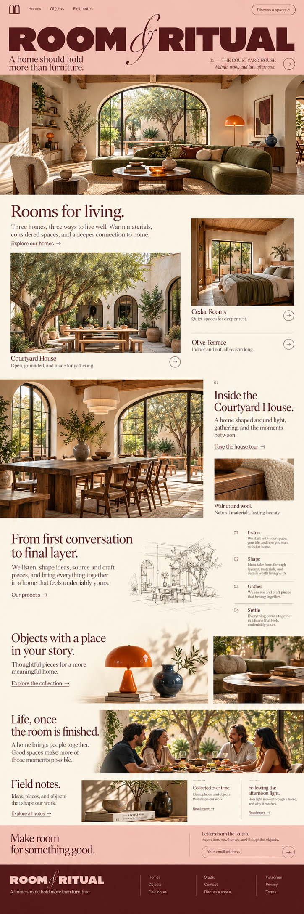
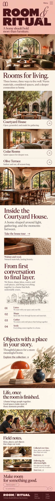

# Room & Ritual — complete review

[All five](../index.html) · [Interaction specification](../specs/02-room-and-ritual.md)

## Desktop and mobile — same homepage

| Desktop | Mobile |
| --- | --- |
|  |  |

Preserve the oversized masthead on two lines. Home stories stack as large photographs with captions; the second home is inset slightly, and Olive Terrace remains a text link. Process becomes a short vertical list.

[Mobile prompt set, references and every tout behavior](../specs/mobile-02-room-and-ritual.md) · [Mobile research](../research/mobile.md) · [Mobile React contract](../specs/react-mobile-contract.md)

## Exact generation prompt

Input 1: approved hero. Input 2: first long concept.

```text
Use case: ui-mockup / art-directed revision of a complete long desktop homepage.

Make ONE single long, complete desktop website screenshot at width:height 1:3, target 1536 x 4608 or maximum useful native resolution. No presentation frame, browser chrome, multiple pages, labels or annotations. Make it look like a serious designed desktop website with several columns, not a narrow mobile site.

REFERENCE 1 is the ORIGINAL APPROVED HERO. It is the strict visual authority. Preserve its brand, photograph, product shape, lettering, art direction, colors and geometry at the top in the original aspect ratio (~19–21% of this long page). Do not reinterpret or rename it.
REFERENCE 2 is the FIRST LONG HOMEPAGE, supplied to show the current direction. Retain its brand world but REBUILD THE BELOW-FOLD LAYOUT. Its flaw is excessive stacked bands, equal-size grids and crowded boxy sections. The new image must visibly correct that flaw, not reproduce it.

The user likes the themes and requests more breathing room, organic pacing, and a stronger continuation of the open approved hero. Organic means natural light, material detail, unequal image scale, offset editorial compositions and generous negative space. It does NOT mean adding wavy borders, bubble cards, cutout blob masks or decorative curves. Keep photographs rectangular, objects and architecture undistorted. Do not bend architecture or stretch images. Do not shrink body copy to fit.

Reduce the visible modules by combining related stories. Seven major compositions including hero/close are specified below. These contain the needed product/project discovery, deeper story, material/process context, human editorial, help/journal and a complete newsletter/footer. Show real working-looking interactive affordances: persistent descriptive links, clear selected controls, restrained underline links, genuine email field. Never print a hover-state diagram or development annotation. Default selected state only. No every-section identical left title rail. No repeated three-column photo strips. No tightly stacked touching colored bands. At least two substantial spans of uninterrupted warm ivory negative space between major image compositions.

Text: short, confident headings and concise real English. Exact brand and product names. No invented awards, reviews, metrics, certification or clinical promises. Prices if specified are concept prices. Full newsletter and footer visible. No clipped page bottom.

BRAND: Room & Ritual
REVISION PRIORITY: Retain the expressive pink masthead. Replace the small repeated interior grids with two offset homes, a substantial house tour and a few isolated objects. Materials become annotations within the house story; process becomes a restrained text sequence.
SPACING DIRECTION: Desktop chapter gaps 144–192 px; 6% side gutters. Project offset 96 px, disabled below 768 px. Pink appears at the masthead and closing invitation, not between every section.

PAGE COMPOSITIONS IN ORDER:
1. Approved ROOM & RITUAL pink masthead and entire arched-window interior hero.

2. Generous warm ivory pause. Rooms for living: large Courtyard House photograph left; smaller Cedar Rooms portrait offset lower at right; Olive Terrace a text link beneath. Avoid equal three-card strip.

3. Inside the Courtyard House: one immersive dining-room image with one narrow prose block next to it. An offset small walnut/wool detail with minimal captions continues below; no four-tile material row.

4. From first conversation to final layer: four elegant text labels Listen, Shape, Gather, Settle in plenty of white space; a single small studio drawing, no boxes.

5. Objects with a place in your story: freestanding orange mushroom lamp and dark ceramic vessel on cream, one modest still life of walnut table. Unequal scales with air, not three product cards. Omit prices in image.

6. Life, once the room is finished: a large warm courtyard gathering photograph. Field notes become two quiet text links with a single offset vignette below, not multiple thumbnail rails.

7. Soft pink generous inquiry and newsletter, followed by full dark burgundy footer.

Final visual check: faithful approved hero, much more open below the fold than reference 2, no repeated boxes, meaningful contextual photography, cohesive typography, full usable-looking footer. Do not add a page title outside the website.

```

## References

- [Studio Ashby — Projects](https://studioashby.com/projects/) — Browser scroll, screenshot and click.
- [Studio Ashby — Tamodi Estate](https://studioashby.com/project/tamodi-estate/) — Browser navigation + DOM.
- [Workstead — Studio and lighting](https://workstead.com/) — Primary-page content.
- [Workstead — Project inquiry](https://workstead.com/project-inquiry/) — Primary-page content; no submission.

[Observed findings and screenshots](../research/live-reference-register.md) · [All 25 category references](../research/desktop.html)

## Page sequence

1. Approved ROOM & RITUAL pink masthead and entire arched-window interior hero.
2. Generous warm ivory pause. Rooms for living: large Courtyard House photograph left; smaller Cedar Rooms portrait offset lower at right; Olive Terrace a text link beneath. Avoid equal three-card strip.
3. Inside the Courtyard House: one immersive dining-room image with one narrow prose block next to it. An offset small walnut/wool detail with minimal captions continues below; no four-tile material row.
4. From first conversation to final layer: four elegant text labels Listen, Shape, Gather, Settle in plenty of white space; a single small studio drawing, no boxes.
5. Objects with a place in your story: freestanding orange mushroom lamp and dark ceramic vessel on cream, one modest still life of walnut table. Unequal scales with air, not three product cards. Omit prices in image.
6. Life, once the room is finished: a large warm courtyard gathering photograph. Field notes become two quiet text links with a single offset vignette below, not multiple thumbnail rails.
7. Soft pink generous inquiry and newsletter, followed by full dark burgundy footer.

## Interactions and React

[All ten touts with scroll, hover, focus, touch, activation and component ownership](../specs/02-room-and-ritual.md).

[Shared React contract](../specs/react-interaction-contract.md) · [Image manifest](../manifest.json)
