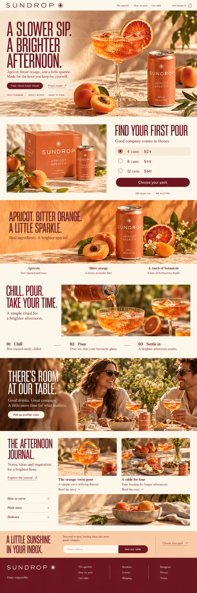
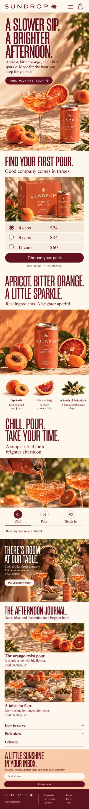

# Sundrop — complete review

[All five](../index.html) · [Interaction specification](../specs/04-sundrop.md)

## Desktop and mobile — same homepage

| Desktop | Mobile |
| --- | --- |
|  |  |

Place the portrait drink scene above the pack chooser. Pack options become full-width radio rows with a single clear selected state. Serving steps remain visible tap buttons; no fixed checkout bar.

[Mobile prompt set, references and every tout behavior](../specs/mobile-04-sundrop.md) · [Mobile research](../research/mobile.md) · [Mobile React contract](../specs/react-mobile-contract.md)

## Exact generation prompt

Input 1: approved hero. Input 2: first long concept.

```text
Use case: ui-mockup / art-directed revision of a complete long desktop homepage.

Make ONE single long, complete desktop website screenshot at width:height 1:3, target 1536 x 4608 or maximum useful native resolution. No presentation frame, browser chrome, multiple pages, labels or annotations. Make it look like a serious designed desktop website with several columns, not a narrow mobile site.

REFERENCE 1 is the ORIGINAL APPROVED HERO. It is the strict visual authority. Preserve its brand, photograph, product shape, lettering, art direction, colors and geometry at the top in the original aspect ratio (~19–21% of this long page). Do not reinterpret or rename it.
REFERENCE 2 is the FIRST LONG HOMEPAGE, supplied to show the current direction. Retain its brand world but REBUILD THE BELOW-FOLD LAYOUT. Its flaw is excessive stacked bands, equal-size grids and crowded boxy sections. The new image must visibly correct that flaw, not reproduce it.

The user likes the themes and requests more breathing room, organic pacing, and a stronger continuation of the open approved hero. Organic means natural light, material detail, unequal image scale, offset editorial compositions and generous negative space. It does NOT mean adding wavy borders, bubble cards, cutout blob masks or decorative curves. Keep photographs rectangular, objects and architecture undistorted. Do not bend architecture or stretch images. Do not shrink body copy to fit.

Reduce the visible modules by combining related stories. Seven major compositions including hero/close are specified below. These contain the needed product/project discovery, deeper story, material/process context, human editorial, help/journal and a complete newsletter/footer. Show real working-looking interactive affordances: persistent descriptive links, clear selected controls, restrained underline links, genuine email field. Never print a hover-state diagram or development annotation. Default selected state only. No every-section identical left title rail. No repeated three-column photo strips. No tightly stacked touching colored bands. At least two substantial spans of uninterrupted warm ivory negative space between major image compositions.

Text: short, confident headings and concise real English. Exact brand and product names. No invented awards, reviews, metrics, certification or clinical promises. Prices if specified are concept prices. Full newsletter and footer visible. No clipped page bottom.

BRAND: Sundrop
REVISION PRIORITY: Keep the sunlit product world and narrow wine-red display type. Replace the three boxed packs with one configurable still life. Merge flavor and ingredient panels; show serving as one dominant image and three explicit steps.
SPACING DIRECTION: Chapter gaps 128–176 px. Cream surrounds citrus and pack objects; orange used once for the flavor scene. Three equal grids never appear back-to-back.

PAGE COMPOSITIONS IN ORDER:
1. Approved Sundrop hero with apricot spritz, ribbed coupe, coral 200 ml can and 8% ALC/VOL.

2. Find your first pour: very spacious ivory area with one carton and one coral can on the left, elegant 4 cans / 8 cans / 12 cans radio-style labels on right. Selected 4 cans $24; other values $44 and $60. One Choose your pack button. No three cards.

3. Apricot. Bitter orange. A little sparkle.: one beautifully composed large orange/coral still life with can and naturally scattered real fruit, not three ingredient tiles. Three small external labels under image, no icons.

4. Chill. Pour. Take your time.: one large pouring photograph with wide cream margins. Three textual step selectors beneath, 01 Chill / 02 Pour / 03 Settle in. No three equal thumbnails.

5. There's room at our table: one warm full-width editorial gathering image. Under it one small offset detail of a table and a few lines; no stacked community grids.

6. The afternoon journal: two unequal photo-and-caption stories The orange-twist pour / A table for four, separated by substantial space. Three tiny FAQ rows nearby: How to serve / Pack sizes / Delivery.

7. A little sunshine in your inbox: open apricot signup area; full burgundy footer and Enjoy responsibly.

Final visual check: faithful approved hero, much more open below the fold than reference 2, no repeated boxes, meaningful contextual photography, cohesive typography, full usable-looking footer. Do not add a page title outside the website.

```

## References

- [Ghia — Homepage shop module](https://drinkghia.com/) — Browser click + selected panel + screenshot.
- [Pentire — Serves](https://pentiredrinks.com/blogs/serves) — Primary-page content.
- [Pentire — Community](https://pentiredrinks.com/blogs/news) — Primary-page content.

[Observed findings and screenshots](../research/live-reference-register.md) · [All 25 category references](../research/desktop.html)

## Page sequence

1. Approved Sundrop hero with apricot spritz, ribbed coupe, coral 200 ml can and 8% ALC/VOL.
2. Find your first pour: very spacious ivory area with one carton and one coral can on the left, elegant 4 cans / 8 cans / 12 cans radio-style labels on right. Selected 4 cans $24; other values $44 and $60. One Choose your pack button. No three cards.
3. Apricot. Bitter orange. A little sparkle.: one beautifully composed large orange/coral still life with can and naturally scattered real fruit, not three ingredient tiles. Three small external labels under image, no icons.
4. Chill. Pour. Take your time.: one large pouring photograph with wide cream margins. Three textual step selectors beneath, 01 Chill / 02 Pour / 03 Settle in. No three equal thumbnails.
5. There's room at our table: one warm full-width editorial gathering image. Under it one small offset detail of a table and a few lines; no stacked community grids.
6. The afternoon journal: two unequal photo-and-caption stories The orange-twist pour / A table for four, separated by substantial space. Three tiny FAQ rows nearby: How to serve / Pack sizes / Delivery.
7. A little sunshine in your inbox: open apricot signup area; full burgundy footer and Enjoy responsibly.

## Interactions and React

[All ten touts with scroll, hover, focus, touch, activation and component ownership](../specs/04-sundrop.md).

[Shared React contract](../specs/react-interaction-contract.md) · [Image manifest](../manifest.json)
