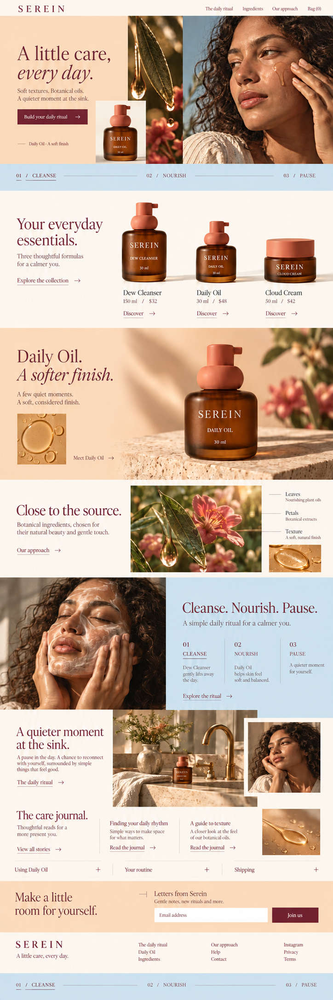
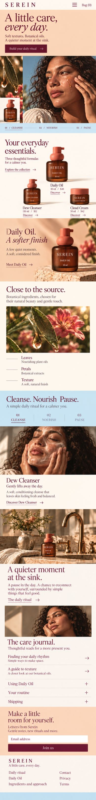

# Serein — complete review

[All five](../index.html) · [Interaction specification](../specs/05-serein.md)

## Desktop and mobile — same homepage

| Desktop | Mobile |
| --- | --- |
|  |  |

The desktop split hero becomes copy then portrait, with the Daily Oil inset retained. Product details stay visible. Routine selection becomes three tap buttons above one stable panel; help becomes a vertical disclosure list.

[Mobile prompt set, references and every tout behavior](../specs/mobile-05-serein.md) · [Mobile research](../research/mobile.md) · [Mobile React contract](../specs/react-mobile-contract.md)

## Exact generation prompt

Input 1: approved hero. Input 2: first long concept.

```text
Use case: ui-mockup / art-directed revision of a complete long desktop homepage.

Make ONE single long, complete desktop website screenshot at width:height 1:3, target 1536 x 4608 or maximum useful native resolution. No presentation frame, browser chrome, multiple pages, labels or annotations. Make it look like a serious designed desktop website with several columns, not a narrow mobile site.

REFERENCE 1 is the ORIGINAL APPROVED HERO. It is the strict visual authority. Preserve its brand, photograph, product shape, lettering, art direction, colors and geometry at the top in the original aspect ratio (~19–21% of this long page). Do not reinterpret or rename it.
REFERENCE 2 is the FIRST LONG HOMEPAGE, supplied to show the current direction. Retain its brand world but REBUILD THE BELOW-FOLD LAYOUT. Its flaw is excessive stacked bands, equal-size grids and crowded boxy sections. The new image must visibly correct that flaw, not reproduce it.

The user likes the themes and requests more breathing room, organic pacing, and a stronger continuation of the open approved hero. Organic means natural light, material detail, unequal image scale, offset editorial compositions and generous negative space. It does NOT mean adding wavy borders, bubble cards, cutout blob masks or decorative curves. Keep photographs rectangular, objects and architecture undistorted. Do not bend architecture or stretch images. Do not shrink body copy to fit.

Reduce the visible modules by combining related stories. Seven major compositions including hero/close are specified below. These contain the needed product/project discovery, deeper story, material/process context, human editorial, help/journal and a complete newsletter/footer. Show real working-looking interactive affordances: persistent descriptive links, clear selected controls, restrained underline links, genuine email field. Never print a hover-state diagram or development annotation. Default selected state only. No every-section identical left title rail. No repeated three-column photo strips. No tightly stacked touching colored bands. At least two substantial spans of uninterrupted warm ivory negative space between major image compositions.

Text: short, confident headings and concise real English. Exact brand and product names. No invented awards, reviews, metrics, certification or clinical promises. Prices if specified are concept prices. Full newsletter and footer visible. No clipped page bottom.

BRAND: Serein
REVISION PRIORITY: The color direction works; remove the sequence of repetitive three-image strips. Give Daily Oil a generous hero-like lower section. Botanical source material becomes one image with annotations; routine becomes a calm stateful scene.
SPACING DIRECTION: Desktop chapter gaps 144–192 px. Peach and blue used as large calm fields; 5–7% gutters. Product bottles float on cream; no enclosing tiles.

PAGE COMPOSITIONS IN ORDER:
1. Approved SEREIN hero: peach copy, botanical center strip, brown-skinned adult model on blue, Daily Oil 30 ml amber squat bottle with sculptural coral pump.

2. Your everyday essentials: three bottles/jar on one continuous cream ground with generous space, no rectangles. Dew Cleanser 150 ml $32 / Daily Oil 30 ml $48 / Cloud Cream 50 ml $42. Do not label cleanser as oil.

3. Daily Oil. A softer finish.: large faithful Daily Oil bottle and one tiny oil texture on expansive peach ground; much more blank space, short serif copy left. Preserve 30 ml, squat amber glass, sculptural coral pump.

4. Close to the source: one large sunlit botanical macro photograph and one little drop-of-oil detail offset, minimal Leaves / Petals / Texture notes. No ingredient-card triptych.

5. Cleanse. Nourish. Pause.: powder blue area with ONE large warm portrait and three elegant selectable step labels. Description and Daily Oil reference sit quietly beside portrait. No three thumbnail row.

6. A quieter moment at the sink: large warm sink scene, with a smaller candid portrait offset below-right and two community captions. The care journal becomes two airy text links and ONE texture detail. No repeated card grid.

7. Make a little room for yourself: calm peach signup with proper email and button; complete cream footer, optional slender blue ritual baseline.

Final visual check: faithful approved hero, much more open below the fold than reference 2, no repeated boxes, meaningful contextual photography, cohesive typography, full usable-looking footer. Do not add a page title outside the website.

```

### Final correction prompt

Input 1: archived round-two candidate. Input 2: approved original.

```text
Edit the attached long Serein homepage (IMAGE 1). IMAGE 2 is the approved original hero and is the exact authority for the top. Keep the new open below-fold layout, full long 1:3 desktop page and complete footer. Correct the missing hero elements: restore the original small inset Daily Oil product bottle on its cream rectangle overlapping the lower left/center botanical border, exactly like IMAGE 2, with squat amber glass, sculptural coral pump, SEREIN / DAILY OIL / 30 ml. Restore the powder-blue 01 CLEANSE / 02 NOURISH / 03 PAUSE strip immediately under the full hero at its original proportions. Do not crop the model or alter the original header photo, typography or color layout. The hero must remain the same height-to-width ratio as IMAGE 2; allow downstream content to move lower, never squash the hero. Below the hero preserve the new floating unboxed products, spacious large Daily Oil section, one botanical composition, blue ritual section with one portrait, offset sink editorial, sparse care journal, newsletter and footer. In the blue ritual selector make 01 CLEANSE visually selected with a thin underline and retain 02 NOURISH and 03 PAUSE as clear text buttons, not cards. Add three quiet thin help rows under the journal: Using Daily Oil +, Your routine +, Shipping +. Use short text and generous whitespace. No new clinical claims. Keep all images geometrically true and all copy legible. One long website screenshot only.

```

## References

- [Vintner’s Daughter — Products and stories](https://vintnersdaughter.com/) — Primary-page content.
- [Botnia — Homepage](https://www.botniaskincare.com/) — Browser category click + DOM + screenshot.
- [Botnia — Key ingredients](https://www.botniaskincare.com/blogs/key-ingredients) — Primary-page content.
- [Botnia — Find your skincare routine](https://www.botniaskincare.com/pages/find-your-skincare-routine) — Primary-page content; no form submission.

[Observed findings and screenshots](../research/live-reference-register.md) · [All 25 category references](../research/desktop.html)

## Page sequence

1. Approved SEREIN hero: peach copy, botanical center strip, brown-skinned adult model on blue, Daily Oil 30 ml amber squat bottle with sculptural coral pump.
2. Your everyday essentials: three bottles/jar on one continuous cream ground with generous space, no rectangles. Dew Cleanser 150 ml $32 / Daily Oil 30 ml $48 / Cloud Cream 50 ml $42. Do not label cleanser as oil.
3. Daily Oil. A softer finish.: large faithful Daily Oil bottle and one tiny oil texture on expansive peach ground; much more blank space, short serif copy left. Preserve 30 ml, squat amber glass, sculptural coral pump.
4. Close to the source: one large sunlit botanical macro photograph and one little drop-of-oil detail offset, minimal Leaves / Petals / Texture notes. No ingredient-card triptych.
5. Cleanse. Nourish. Pause.: powder blue area with ONE large warm portrait and three elegant selectable step labels. Description and Daily Oil reference sit quietly beside portrait. No three thumbnail row.
6. A quieter moment at the sink: large warm sink scene, with a smaller candid portrait offset below-right and two community captions. The care journal becomes two airy text links and ONE texture detail. No repeated card grid.
7. Make a little room for yourself: calm peach signup with proper email and button; complete cream footer, optional slender blue ritual baseline.

## Interactions and React

[All ten touts with scroll, hover, focus, touch, activation and component ownership](../specs/05-serein.md).

[Shared React contract](../specs/react-interaction-contract.md) · [Image manifest](../manifest.json)
