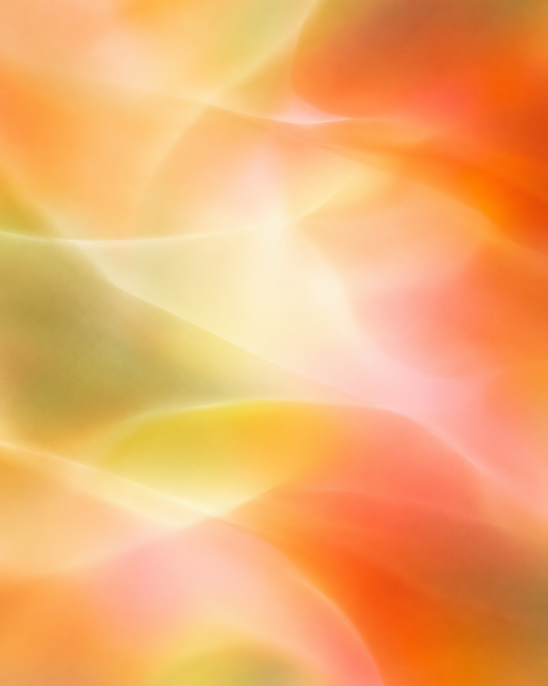
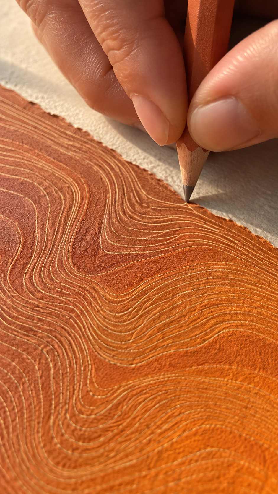
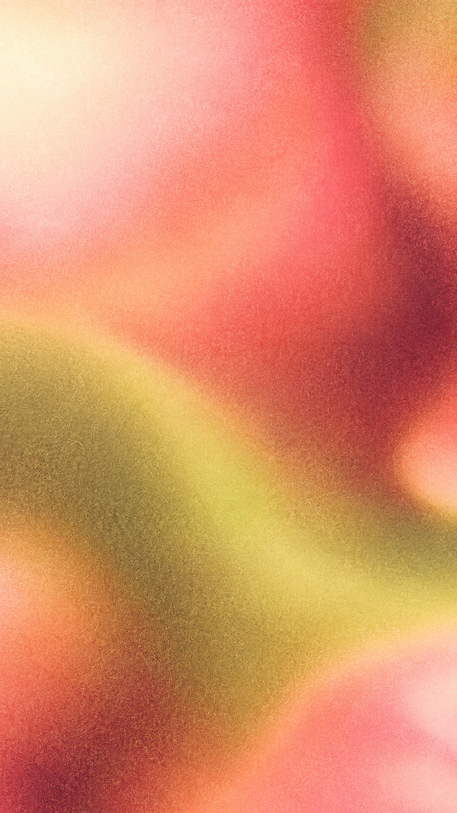

# Colors

[All image folders](../README.md)

## Generated textures

- [Apricot and citron — Soft light field](generated-textures/19-apricot-citron-light.png)
- [Canyon lines — Handcrafted surface](generated-textures/20-canyon-lines-craft.png)
- [Rosette and moss — Grain field](generated-textures/21-rosette-moss-grain.png)
- [Courtyard light — Optical texture](generated-textures/22-courtyard-light-bokeh.png)
- [Woven light — Translucent fabric](generated-textures/23-woven-light.png)
- [Mineral impressions — Clay relief](generated-textures/24-mineral-impressions.png)
- [Sienna silk](generated-textures/07-sienna-silk.png)
- [Moss linen](generated-textures/08-moss-linen.png)
- [Peach travertine](generated-textures/09-peach-travertine.png)
- [Honey caustics](generated-textures/10-honey-caustics.png)
- [Coral paper](generated-textures/11-coral-paper.png)
- [Cream glaze](generated-textures/12-cream-glaze.png)

## Original color references

- [Vivid warm palette](original-references/01-vivid-warm-palette.png)
- [Coral, honey and moss palettes](original-references/02-coral-honey-and-moss-palettes.png)
- [Coral and citron grain](original-references/03-coral-and-citron-grain.png)
- [Moss, citron and rosette swatches](original-references/04-moss-citron-and-rosette-swatches.png)
- [Backlit amber fabric](original-references/05-backlit-amber-fabric.png)
- [Translucent curtains and foliage](original-references/06-translucent-curtains-and-foliage.png)
- [Terracotta plaster and shadow](original-references/07-terracotta-plaster-and-shadow.png)
- [Apricot window light](original-references/08-apricot-window-light.png)
- [Natural material bands](original-references/09-natural-material-bands.png)
- [Earth and foliage palette](original-references/10-earth-and-foliage-palette.png)
- [Natural texture collection](original-references/11-natural-texture-collection.png)
- [Layered material samples](original-references/12-layered-material-samples.png)
- [Burgundy, orange and sea palette](original-references/13-burgundy-orange-and-sea-palette.png)
- [Velvet and wood palette](original-references/14-velvet-and-wood-palette.png)
- [Dimensional material samples](original-references/15-dimensional-material-samples.png)
- [Leather, cork and terrazzo](original-references/16-leather-cork-and-terrazzo.png)
- [Curled warm paint swatches](original-references/17-curled-warm-paint-swatches.png)
- [Peach, sage and navy paper](original-references/18-peach-sage-and-navy-paper.png)
- [Ceramic glaze samples](original-references/19-ceramic-glaze-samples.png)
- [Warm architectural materials](original-references/20-warm-architectural-materials.png)
- [Orange tactile surface](original-references/21-orange-tactile-surface.png)
- [Peach mineral powder](original-references/22-peach-mineral-powder.png)
- [Amber liquid and bubbles](original-references/23-amber-liquid-and-bubbles.png)
- [Golden-hour portrait](original-references/24-golden-hour-portrait.png)
- [Warm interior and light](original-references/25-warm-interior-and-light.png)
- [Pearlescent warm folds](original-references/26-pearlescent-warm-folds.png)
- [Luminous coral gradient](original-references/27-luminous-coral-gradient.png)
- [Blurred amber, butter and moss](original-references/28-blurred-amber-butter-and-moss.png)
- [Ochre wall and botanical shadows](original-references/29-ochre-wall-and-botanical-shadows.png)
- [Amber product color and finish](original-references/30-amber-product-color-and-finish.png)
- [Coral product color and finish](original-references/31-coral-product-color-and-finish.png)
- [Red product color and finish](original-references/32-red-product-color-and-finish.png)
- [Apricot and citron light](original-references/33-apricot-and-citron-light.png)
- [Canyon texture](original-references/34-canyon-texture.png)
- [Rosette and moss grain](original-references/35-rosette-and-moss-grain.png)
- [Courtyard optical light](original-references/36-courtyard-optical-light.png)
- [3D color and material composition 1](original-references/37-3d-color-and-material-composition-1.png)
- [3D color and material composition 2](original-references/38-3d-color-and-material-composition-2.png)
- [3D color and material composition 3](original-references/39-3d-color-and-material-composition-3.png)
- [3D color and material composition 4](original-references/40-3d-color-and-material-composition-4.png)
- [3D color and material composition 5](original-references/41-3d-color-and-material-composition-5.png)
- [3D color and material composition 6](original-references/42-3d-color-and-material-composition-6.png)

## Preview

