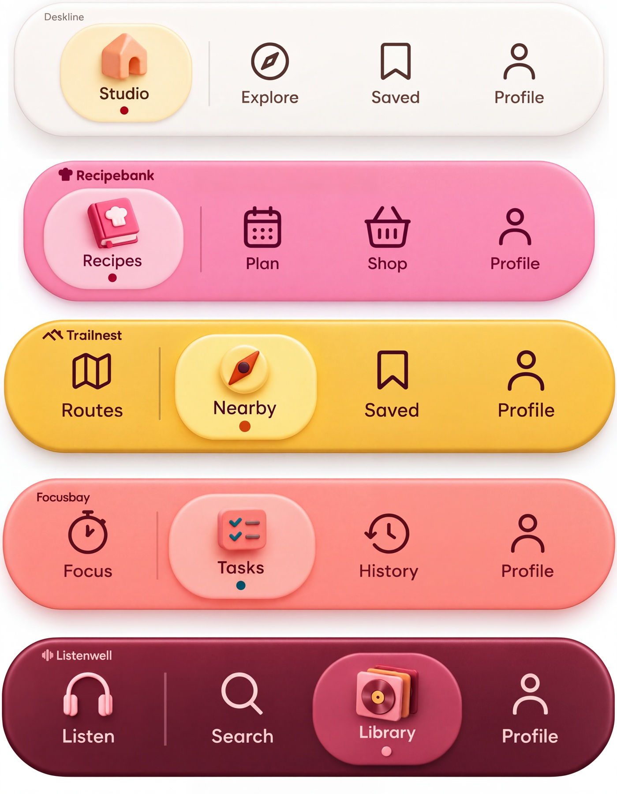

# Dock

Nano Banana 2 Cleanup, maintained by Jason Festa.

5 designs · 3,648 × 4,692 pixels · Nano Banana 2, 4K setting for the entire sheet.

[Full output PNG](output.png) · [Exact input PNG](input.png) · [Cleanup prompt](prompt.md) · [Generation metadata](metadata.json)

Review: Five docks retain their natural proportions. Reviewed four destinations per dock, correct order, unique brands and single active destination. This is one of the cleanest results.

To regenerate, submit `input.png` as the reference image and the entire `prompt.md` as the edit prompt using the settings in `metadata.json`. The collection heading in the prompt was renamed to Nano Banana 2 Cleanup after generation; its design instructions are retained. The preview is uniformly downsampled; the output PNG is unaltered.
