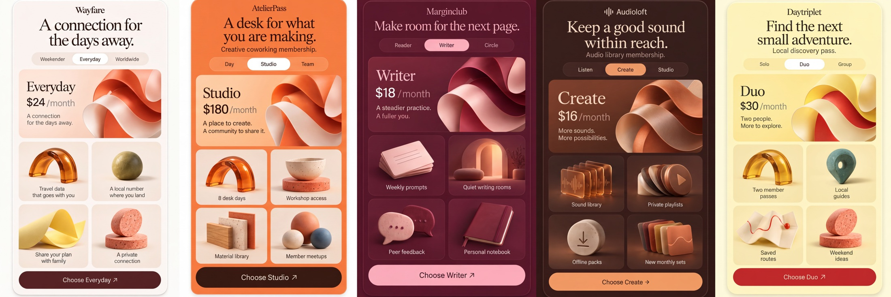

# Membership

Nano Banana 2 Cleanup, maintained by Jason Festa.

5 designs · 7,104 × 2,368 pixels · Nano Banana 2, 4K setting for the entire sheet.

[Full output PNG](output.png) · [Exact input PNG](input.png) · [Cleanup prompt](prompt.md) · [Generation metadata](metadata.json)

Review: Five plan cards, selected plans, prices and CTA names are readable. AtelierPass changed from a cream surface to strong orange; palette intent was restored but this is a visible change from the supplied input.

To regenerate, submit `input.png` as the reference image and the entire `prompt.md` as the edit prompt using the settings in `metadata.json`. The collection heading in the prompt was renamed to Nano Banana 2 Cleanup after generation; its design instructions are retained. The preview is uniformly downsampled; the output PNG is unaltered.
