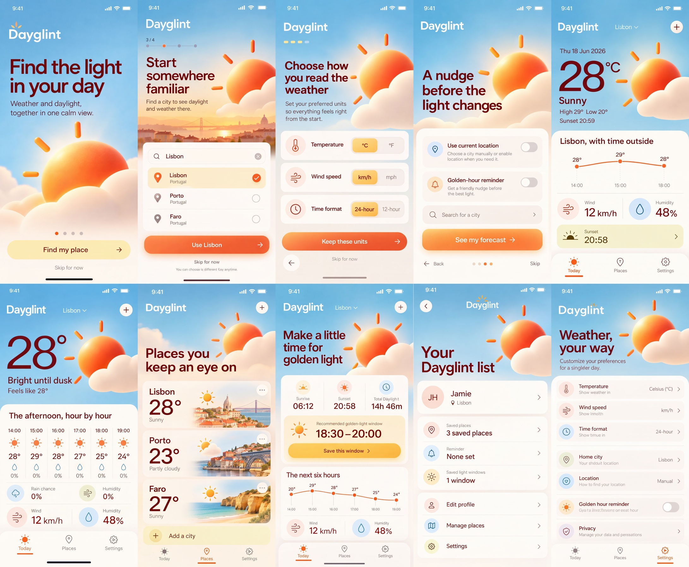

# Dayglint

Nano Banana 2 Cleanup, maintained by Jason Festa.

10 designs · 4,544 × 3,748 pixels · Nano Banana 2, 4K setting for the entire sheet.

[Full output PNG](output.png) · [Exact input PNG](input.png) · [Cleanup prompt](prompt.md) · [Generation metadata](metadata.json)

Review: Ten screens retained. Onboarding step 2 is labeled 3/4; sunset values disagree, and the hourly screen adds inconsistent duplicate metric rows. Not state-accurate.

To regenerate, submit `input.png` as the reference image and the entire `prompt.md` as the edit prompt using the settings in `metadata.json`. The collection heading in the prompt was renamed to Nano Banana 2 Cleanup after generation; its design instructions are retained. The preview is uniformly downsampled; the output PNG is unaltered.
