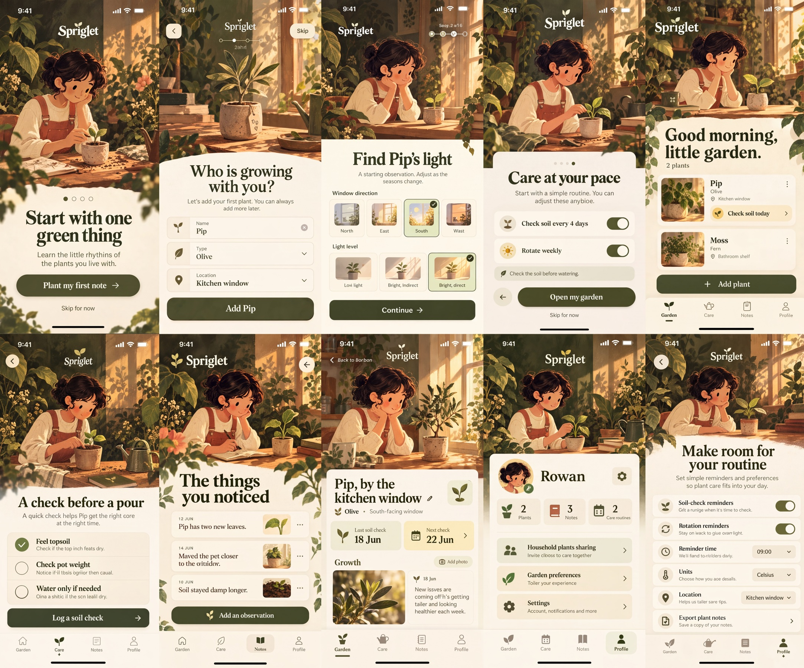

# Spriglet

Nano Banana 2 Cleanup, maintained by Jason Festa.

10 designs · 4,544 × 3,776 pixels · Nano Banana 2, 4K setting for the entire sheet.

[Full output PNG](output.png) · [Exact input PNG](input.png) · [Cleanup prompt](prompt.md) · [Generation metadata](metadata.json)

Review: Authorized retry returned ten screens at 4544 × 3776; overall ratio differs by 0.7363%. The botanical aesthetic and main screen structure remain. Onboarding labels, several supporting lines, the 18 Jun note date (now 12 Jun), and navigation icons are still inaccurate. Not approved for final copy or state accuracy.

To regenerate, submit `input.png` as the reference image and the entire `prompt.md` as the edit prompt using the settings in `metadata.json`. The collection heading in the prompt was renamed to Nano Banana 2 Cleanup after generation; its design instructions are retained. The preview is uniformly downsampled; the output PNG is unaltered.
