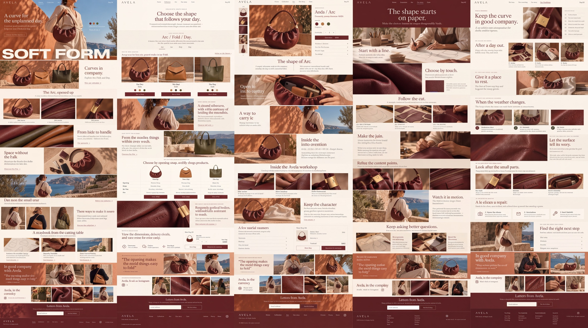

# Avela

Nano Banana 2 Cleanup, maintained by Jason Festa.

5 designs · 5,504 × 3,072 pixels · Nano Banana 2, 4K setting for the entire sheet.

[Full output PNG](output.png) · [Exact input PNG](input.png) · [Cleanup prompt](prompt.md) · [Generation metadata](metadata.json)

Review: Needs correction: sheet ratio changed by 7.52%; product title became “Aoda / Arc,” and multiple labels/prices are garbled. Not approved as final.

To regenerate, submit `input.png` as the reference image and the entire `prompt.md` as the edit prompt using the settings in `metadata.json`. The collection heading in the prompt was renamed to Nano Banana 2 Cleanup after generation; its design instructions are retained. The preview is uniformly downsampled; the output PNG is unaltered.
