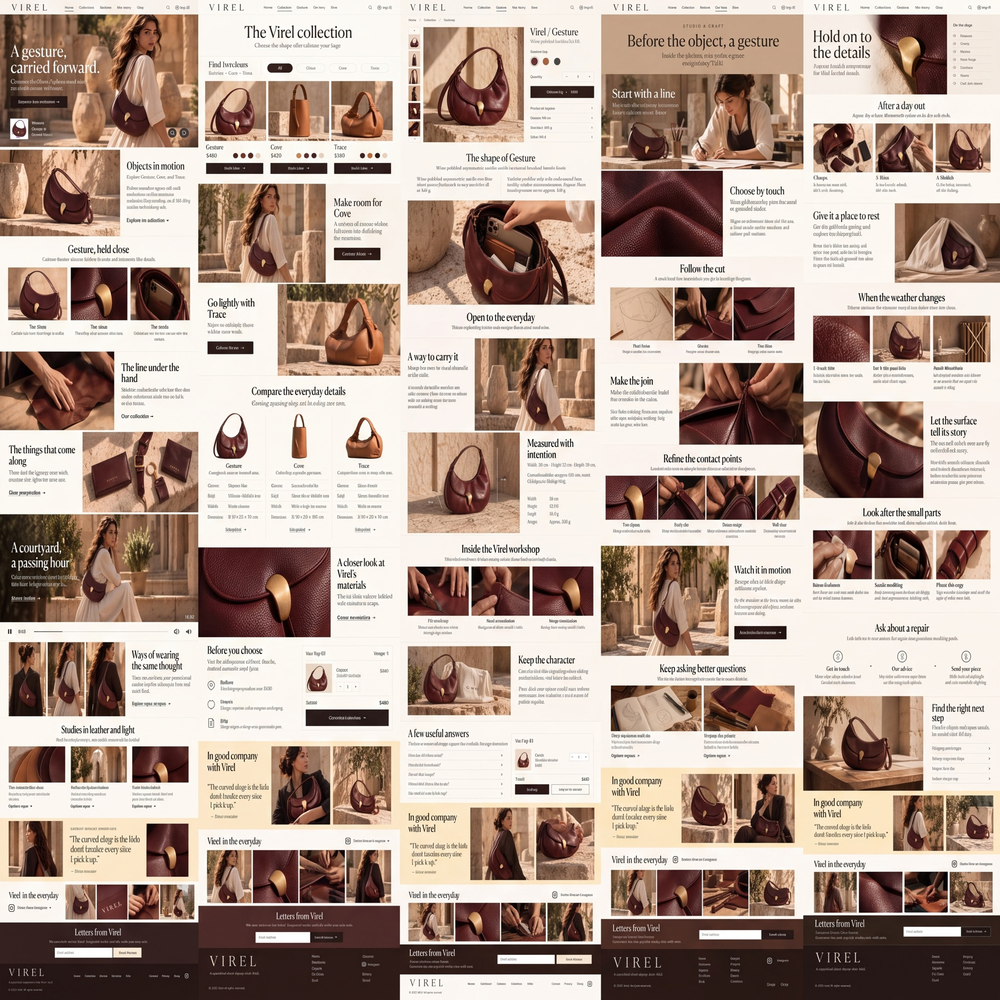

# Virel

Nano Banana 2 Cleanup, maintained by Jason Festa.

5 designs · 4,096 × 4,096 pixels · Nano Banana 2, 4K setting for the entire sheet.

[Full output PNG](output.png) · [Exact input PNG](input.png) · [Cleanup prompt](prompt.md) · [Generation metadata](metadata.json)

Review: Geometry failure: FAL returned a square sheet instead of the supplied 5:3 sheet. Page proportions changed substantially; copy and product consistency also remain incorrect. Unaltered raw result retained for review.

To regenerate, submit `input.png` as the reference image and the entire `prompt.md` as the edit prompt using the settings in `metadata.json`. The collection heading in the prompt was renamed to Nano Banana 2 Cleanup after generation; its design instructions are retained. The preview is uniformly downsampled; the output PNG is unaltered.
