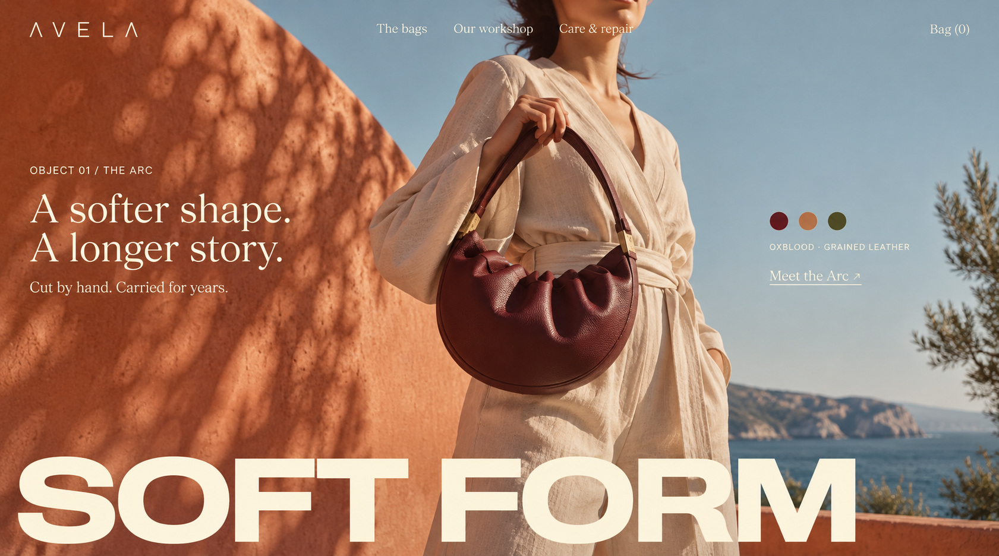
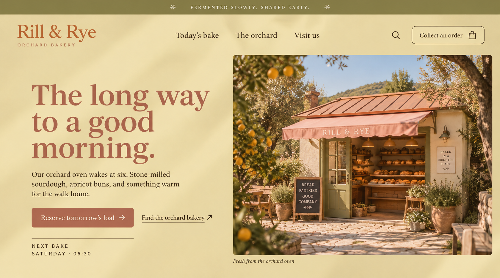
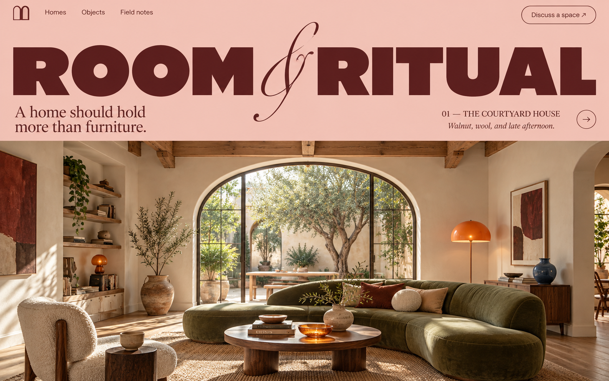

# Website

[All image folders](../README.md)

## Latest image collection — 24 October 2026

[Browse all ten desktop/mobile pairs](final-2026-10-24/README.md) · [Download all 20 images](https://jasonfesta.github.io/WDA/images/website/final-2026-10-24/wda-website-images-2026-10-24.zip)

Selected photographic directions: VIREL B, MELLORE A, Terreno A and Rill & Rye B. The collection preserves the current images at their existing dimensions, including the unchanged AVELA pair. The four selected photographic pairs show the opening and first scroll transition; the other six pairs show full homepage images.

## AVELA approved website pages

[Open the AVELA collection](avela/) — Bags, Our workshop, and Care & repair, with separate desktop/mobile images, native source masters, side-by-side previews, research companions and exact prompts. Jason Festa / WDA.

## Website layouts

- [Avela — The Arc bag](01-avela-arc-bag.png)
- [Rill & Rye — Orchard bakery](02-rill-and-rye-bakery.png)
- [Room & Ritual — The courtyard house](03-room-and-ritual-interiors.png)
- [Oriel — Spaces for gathering](04-oriel-spatial-practice.png)
- [Sundrop — Apricot aperitif](05-sundrop-aperitif.png)
- [Serein — Daily botanical care](06-serein-botanical-care.png)

## Preview

