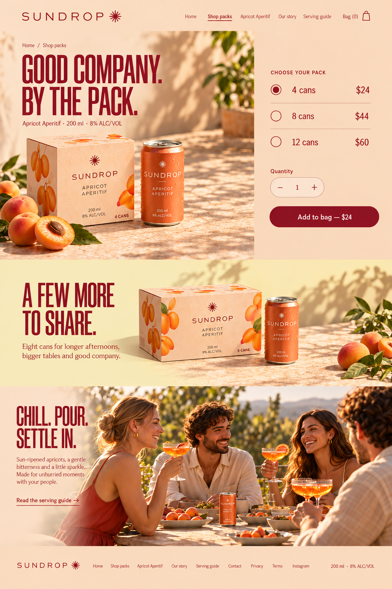
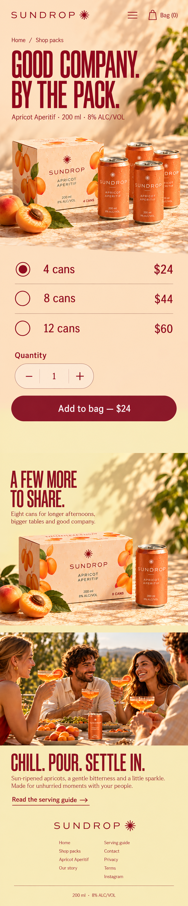
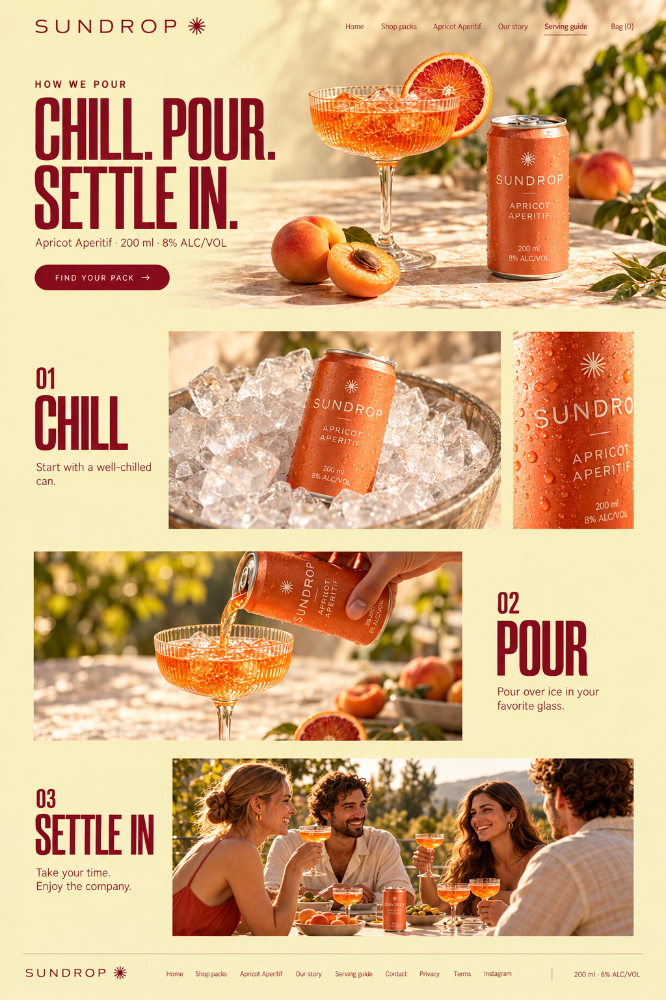
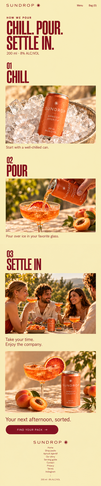

# Sundrop — core pages

Three new destinations, shown as image-only desktop and continuous mobile mockups. Existing approved homepage is preserved.

| Page | Desktop | Mobile |
| --- | --- | --- |
| Shop packs | [Open desktop](01-shop-packs/desktop.png) · 1024×1536 | [Open mobile](01-shop-packs/mobile.png) · 809×3884 |
| Apricot Aperitif | [Open desktop](02-apricot-aperitif/desktop.png) · 1024×1536 | [Open mobile](02-apricot-aperitif/mobile.png) · 806×3887 |
| Serving guide | [Open desktop](03-serving-guide/desktop.png) · 1024×1536 | [Open mobile](03-serving-guide/mobile.png) · 809×3874 |

Native pixels are preserved; no upscaling. Mobile pages are single long images assembled proportionally from independently rendered continuous sections. At 2× density, maximum display widths are documented in [manifest.json](manifest.json). Desktop images are 1024×1536 where listed, not a 1440 px 2× export.

These are visual concepts: controls, typography metrics, accessibility and responsive behavior are not implemented or certified. Exact prompts, ordered image references, hashes, native outputs and visual QA are retained in the production records.

## Page decisions

- **Shop packs** — commerce catalogue.
- **Apricot Aperitif** — product detail.
- **Serving guide** — vertical serving instructions.

## Reference decisions

- [https://drinkghia.com/](https://drinkghia.com/) — Separate choosing a pack, evaluating the drink and learning to serve. Keep chosen pack and price clear, vertical steps on phone. Nonalcoholic reference claims do not transfer.
- [https://drinkghia.com/pages/recipes](https://drinkghia.com/pages/recipes) — Serving layout derives from retained WDA recipe/task research and original hierarchy, not an invented current site observation.

## Desktop and mobile pairs

### Shop packs

| Desktop | Mobile |
| --- | --- |
|  |  |

### Apricot Aperitif

| Desktop | Mobile |
| --- | --- |
|  |  |

### Serving guide

| Desktop | Mobile |
| --- | --- |
|  |  |

