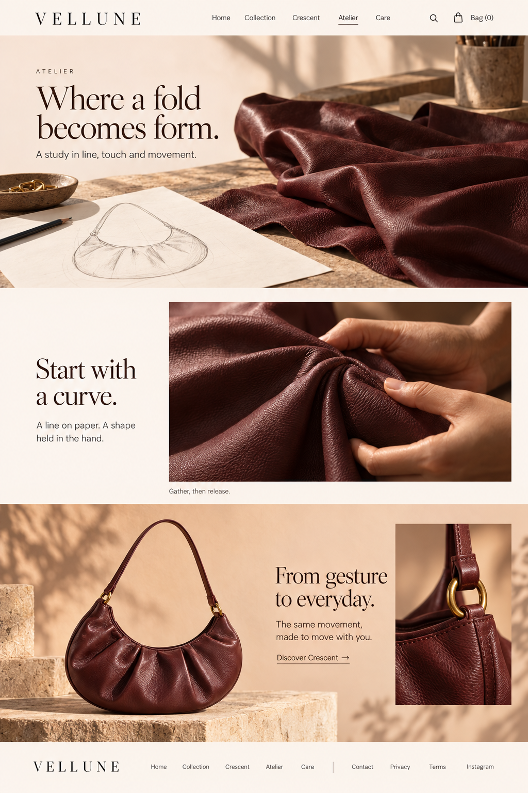
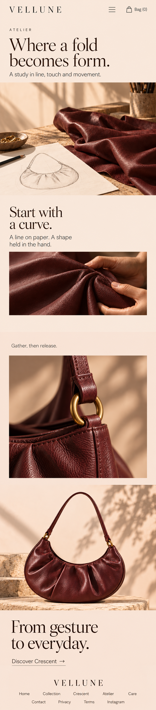

# Vellune — core pages

Three new destinations, shown as image-only desktop and continuous mobile mockups. Existing approved homepage is preserved.

| Page | Desktop | Mobile |
| --- | --- | --- |
| A family of forms | [Open desktop](01-family-of-forms/desktop.png) · 1024×1536 | [Open mobile](01-family-of-forms/mobile.png) · 776×3892 |
| Crescent | [Open desktop](02-crescent/desktop.png) · 1024×1536 | [Open mobile](02-crescent/mobile.png) · 793×3889 |
| Atelier | [Open desktop](03-atelier/desktop.png) · 1024×1536 | [Open mobile](03-atelier/mobile.png) · 809×3647 |

Native pixels are preserved; no upscaling. Mobile pages are single long images assembled proportionally from independently rendered continuous sections. At 2× density, maximum display widths are documented in [manifest.json](manifest.json). Desktop images are 1024×1536 where listed, not a 1440 px 2× export.

These are visual concepts: controls, typography metrics, accessibility and responsive behavior are not implemented or certified. Exact prompts, ordered image references, hashes, native outputs and visual QA are retained in the production records.

## Page decisions

- **A family of forms** — fashion collection.
- **Crescent** — product detail.
- **Atelier** — material and design essay.

## Reference decisions

- [https://eng.polene-paris.com/products/numero-dix-textured-plum](https://eng.polene-paris.com/products/numero-dix-textured-plum) — Keep purchasing legible while changing object scale and editorial rhythm. Do not copy Polene products or claims.
- [https://hereustudio.com/pages/craftmanship](https://hereustudio.com/pages/craftmanship) — Atelier uses three material studies and restrained copy rather than a row of service cards.

## Desktop and mobile pairs

### A family of forms

| Desktop | Mobile |
| --- | --- |
|  |  |

### Crescent

| Desktop | Mobile |
| --- | --- |
|  |  |

### Atelier

| Desktop | Mobile |
| --- | --- |
|  |  |

